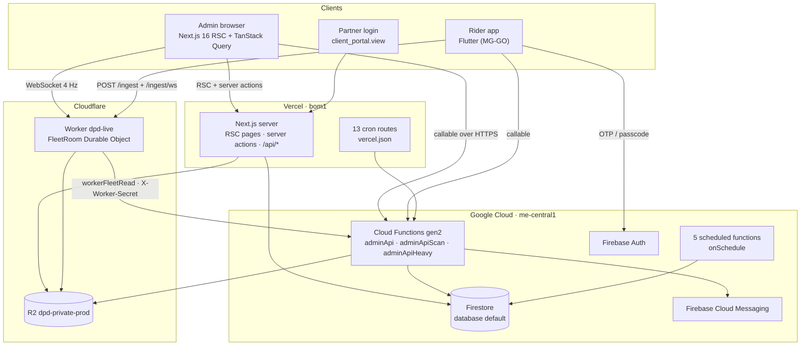
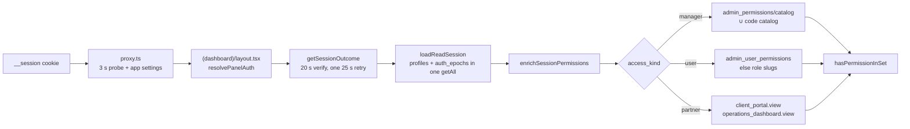
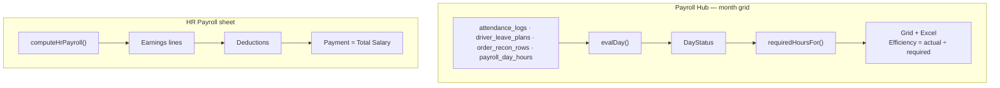

# MGHub — System Architecture & Technical Overview

**Platform:** MGHub Admin & Operations Portal (Musallam Group / DPD)
**Document version:** 1.0 · **Generated:** 13 November 2026
**Sources:** `src/app`, `src/features`, `src/lib`, `functions/src`, `infra/workers/dpd-live`, `supabase/migrations`, `vercel.json`
**Method:** every table, route, function and cron below was read from the repository. Nothing is illustrative.

---

## Table of contents

1. [Executive Summary & Core Modules](#1-executive-summary--core-modules)
2. [Database Schema & Data Models](#2-database-schema--data-models)
3. [Core Application Functions & Business Logic](#3-core-application-functions--business-logic)
4. [Cloud Functions, Serverless Endpoints & Background Jobs](#4-cloud-functions-serverless-endpoints--background-jobs)
5. [Complete Feature Matrix](#5-complete-feature-matrix)
6. [Appendices](#6-appendices)
   - [6.1 Environment variables](#61-environment-variables-names-only)
   - [6.2 Test suites](#62-test-suites-27-npm-run-test-scripts)
   - [6.3 Firestore indexes, TTL and the query budget](#63-firestore-indexes-ttl-and-the-query-budget)
   - [6.4 Cloud Function deployment inventory](#64-cloud-function-deployment-inventory)
   - [6.5 Every route under `src/app/api`](#65-every-route-under-srcappapi)
   - [6.6 Known constraints and open items](#66-known-constraints-and-open-items)

---

## 1. Executive Summary & Core Modules

### 1.1 What the platform is

MGHub is the back-office control tower for a contracted rider workforce: roughly 950 delivery riders across Kuwait, dispatched by third-party partners (Americana, Keeta, Talabat, Uber Eats, Door Dash, Five Guys). **Order allocation is external** — the partner apps decide which rider gets which order. MGHub owns everything around that:

- who the rider is (identity, documents, contracts, residency)
- whether they were present and productive (shift, attendance, GPS, zone discipline)
- what they are paid (per-order incentives, monthly payroll, HR payroll)
- what the client can see (a scoped partner portal)
- the operational surfaces built on top (e-signature, visit bookings, accident cases, fleet maintenance, notifications)

Two clients consume it:

| Client | Repository | Surface |
|---|---|---|
| Admin / staff | `MGgo-Admin` (this repo) | Full back-office web app |
| Rider | `MG-GO` (separate repo) | Flutter app, OTP + passcode login |

A third surface — the Cloudflare Worker `dpd-live` — sits between the rider phones and the admin live map.

### 1.2 Business modules (route inventory, from `src/app/[locale]/(dashboard)`)

| # | Module | Route | Permission | Purpose |
|---|---|---|---|---|
| 1 | **Dashboard / Launcher** | `/dashboard` | `dashboard.view` | Dark launcher grid; the hub of the app |
| 1b | Control Tower | `/dashboard/ops` | `dashboard.view` | KPI snapshot across modules |
| 2 | **Live Tracking V1** | `/live-tracking` | `live_tracking.view` | Durable pin per rider from `driver_locations` |
| 2b | **Live Tracking V2** | `/live-tracking-v2` | `live_tracking.view` | 1 Hz deck.gl canvas over a Cloudflare Durable Object |
| 3 | **Employees** | `/drivers`, `/drivers/[id]`, `/drivers/new`, `/drivers/groups`, `/drivers/dashboard` | `drivers.view` / `drivers.manage` | Rider roster, intake → approval, documents, device link |
| 4 | **Fleet Hub** | `/fleet` → `/vehicles`, `/fuel`, `/assets`, `/fleet/service`, `/fleet/handover`, `/fleet/accident`, `/fleet/rj` | `vehicles.*`, `fuel.*`, `assets.*`, `service.*` | Vehicles, fuel ledger, assets, workshop, handovers, accidents |
| 5 | **Deliveries** | `/deliveries`, `/deliveries/reconciliation`, `/deliveries/zones` | `deliveries.view` / `deliveries.manage`, `order_recon.*` | Verify / reject orders, AM-vs-MGGO comparison |
| 6 | **Payroll Hub** | `/payroll-hub` → `/payroll`, `/payroll/combined`, `/payroll/attendance-orders`, `/payroll/hr`, `/payroll/settings`, `/payroll/pay-plan` | `payroll.*` (10 slugs) | Monthly payroll, HR sheet, rules engine |
| 7 | **Operations Hub** | `/operations` → `/operations/roster` (+ `/roster/upload`, `/roster/changes`, `/roster/alerts`, `/roster/report`) | `attendance.*`, `earnings.*`, `drivers.manage` | Rule tables, shift roster, attendance alerting |
| 8 | **Attendance** | `/attendance` | `attendance.view` / `attendance.manage` | Live presence, logs, exceptions, analytics |
| 9 | **Notifications** | `/notifications` (+ `/new`, `/[id]`, `/history`, `/automations`, `/templates`, `/analytics`) | `notifications.*` (5 slugs) | Campaigns, audiences, FCM dispatch, automations |
| 10 | **Roles & Permissions** | `/settings/roles`, `/settings/staff-access` | `roles.manage`, super admin | 4-level access editor + role matrix |
| 11 | **EmployeeDesk** | `/employeedesk` (+ `/esign/*`, `/visits/*`, `/all`, `/[id]`, `/reports`, `/settings`) | `requests.*`, `esign.*`, `visits.*` | Request & Complaint (RCM), e-signature, visit bookings |
| 12 | **Visit Slots** | `/visit-bookings` (+ `/all`, `/calendar`, `/reception`, `/slots`, `/departments`, `/branches`, `/reports`) | `visits.*` (4 slugs) | Appointment booking for HR/compliance desks |
| 13 | **Performance** | `/performance`, `/performance/settings` | `performance.*` (5 slugs) | SOP v2.0 OPD/DPD/UTR analytics |
| 14 | **Client Portal** | `/client-portal-v2` (+ `/employees`, `/clients`, `/new`, `/preview/[projectKey]`) | `client_portal.view` | Partner-scoped read-only dashboard |
| 15 | **System Settings** | `/settings` (+ 24 sub-pages) | `settings.*` | Branding, menus, languages, catalogs, storage, cleanup |
| 16 | Support / Assistant / Compliance / Wrong actions / Document expiry / Driver devices / Payouts / Earnings / DPD rules | `/support`, `/assistant`, `/compliance`, `/wrong-actions`, `/document-expiry`, `/driver-devices`, `/payouts`, `/earnings`, `/delivery-rules`, `/incentive-rules` | per module | See §5 |

41 top-level route folders under `src/app/[locale]/(dashboard)`, **92 permission slugs** in `src/lib/auth/permission-catalog.ts`.

### 1.3 Tech stack

| Layer | Choice | Where |
|---|---|---|
| **Framework** | Next.js **16.2.6**, App Router, Turbopack, React Server Components | `package.json`, `next.config.ts` |
| **Language** | TypeScript (strict), no `.js` app sources | `tsconfig.json` |
| **Styling** | Tailwind CSS v4 + shadcn/ui primitives on CSS custom properties; single locked navy/green theme | `src/app/globals.css`, `src/app/themes.css`, `src/components/ui/*` |
| **Product components** | `src/components/app/*` (`AppPage`, `AppListCard`, `AppDataTable`, `AppModalFooter`, `TableToolbar`, `AppHubShell`) | shared shell for every page |
| **Server state** | **TanStack Query v5** — one `QueryClient` per browser tab; `staleTime` 60 s, `gcTime` 5 min, `refetchOnWindowFocus: false` | `src/lib/query/*`, `src/components/providers/query-provider.tsx` |
| **Client state** | React hooks + Riverpod-equivalent pattern via context providers; no Redux | `src/contexts/*` |
| **i18n** | **next-intl**, locales `en` + `ar` (RTL), **12,625 keys × 2** with a parity guard | `src/messages/*.json`, `scripts/check-messages.mjs` |
| **Database** | **Firestore** (named database `default`), Admin SDK server-side only | `src/lib/firebase/*`, `functions/src/core/fs.ts` |
| **Auth** | Firebase Auth → **session cookie** (`__session`) verified in `src/proxy.ts`; custom claims carry `superAdmin` | `src/lib/firebase/session.ts`, `src/proxy.ts` |
| **Backend** | **Cloud Functions gen2** (`firebase-functions/v2`) in `me-central1` / `musallam-delivery-prod` | `functions/src` |
| **Real-time (maps)** | **Cloudflare Durable Object** `FleetRoom` + WebSocket, with a Supabase-Broadcast-era poll fallback | `infra/workers/dpd-live` |
| **Object storage** | **Cloudflare R2** `dpd-private-prod` (driver docs, e-sign PDFs, fuel, request attachments, GPS archive) | `src/lib/storage/r2-client.ts` |
| **Hosting** | **Vercel**, region **`bom1`**, `maxDuration` 300 s on the dashboard layout, the order-recon routes and `/deliveries/reconciliation` | `vercel.json`, `(dashboard)/layout.tsx` |
| **Charts** | **Recharts** (Performance trend only) + hand-built CSS/SVG bars elsewhere | `src/features/performance` |
| **Maps** | Google Maps JS + `@vis.gl/react-google-maps`; **deck.gl** for V2; Leaflet for `/zones` editor | `src/features/driver-tracking`, `src/features/live-tracking-v2`, `src/features/zones` |
| **Excel / CSV** | **ExcelJS** (styled workbooks) + **xlsx** (namespace import) + custom CSV writers | `src/lib/*xlsx*`, `src/lib/csv/*` |
| **Push** | **Firebase Cloud Messaging** (FCM) via Admin SDK | `functions/src/rpcs/driver-push-tokens.ts`, `notifications.ts` |
| **PDF** | Chrome print for e-sign sheets; `pdf-lib` for signature stamping | `functions/src/rpcs/esign-compose*` |
| **Observability** | Sentry (client + functions), `perf` JSON logs from the callable router | `src/lib/sentry/*`, `functions/src/perf/*` |



---

## 2. Database Schema & Data Models

### 2.1 Two schemas, one live

The project migrated from **Supabase Postgres** to **Firestore**. Both exist in the tree; only one is live.

| Schema | Status | Location | Count |
|---|---|---|---|
| **Firestore collections** | **Live** — every read and write goes here | `src/lib/firebase/db.ts`, `functions/src/core/collections.ts` | **142 named collections** (+ 6 `uniq_*` lock collections, `counters`) |
| Postgres migrations | **Historical** — the Supabase project `eoksxkdssptgyqyywdju` is paused; admin and Worker no longer call it | `supabase/migrations/*.sql` | 398 files |

> **Read this before writing a query.** A Postgres table name in a migration does **not** mean a live table. `deliveries`, `drivers`, `requests`, `esign_requests` and the rest are Firestore collections now. `src/types/database.ts` is a generated artefact kept for type continuity, not a live schema.

### 2.2 Identity, access and configuration

| Collection | Purpose | Key fields | Relationships |
|---|---|---|---|
| `profiles` | Auth mirror + panel access | `id` (= `auth.uid`), `role` (`staff`\|`rider`), `approval_status` (`pending`\|`approved`\|`rejected`), `admin_role_id`, `access_kind` (`manager`\|`user`\|`partner`), `partner_project_key`, `staff_department`, `sessions_revoked_at`, `archived_at` | 1:1 `drivers`; N:1 `admin_roles` |
| `drivers` | The rider record | `employee_id` (unique, 4–8 digits), `driver_code` (5 digits), `client_id`, `phone`, `civil_id`, `passport_no`, `zone_id`, `partner_id`, `vehicle_id`, `project_key`, `status`, `app_passcode`, `custom_fields` (jsonb), `current_odometer_km`, `avatar_object_key` | N:1 `zones`, `partners`, `vehicles`; M:N `restaurants` via `driver_restaurants` |
| `driver_intakes` | Add-Driver draft before approval | same identity fields + `linked_profile_id`, `archived_at` | 1:1 `drivers` after approve |
| `admin_roles` | Panel role | `slug`, `name`, `is_super_admin` | 1:N `admin_role_permissions` |
| `admin_permissions` | Slug catalog (172 slugs) + `catalog` doc | `slugs: string[]` | — |
| `admin_role_permissions` | Role → slugs | `permission_slugs: string[]` | N:1 `admin_roles` |
| `admin_user_permissions` | Per-user ticks | `permission_slugs: string[]` | 1:1 `profiles` |
| `admin_ui_preferences` | Per-user column order / view | `user_id`, `preference_key`, `value` (`order`, `visible`, `sort`, `groupBy`, `viewMode`) | N:1 `profiles` |
| `admin_role_ui_defaults` | Per-role column defaults | `role_id`, `preference_key`, `value` | N:1 `admin_roles` |
| `admin_activity_logs` | Audit trail | `action`, `entity_type`, `entity_id`, `before`, `after`, `actor_id`, `page_path` | N:1 `profiles` |
| `auth_epochs` | Cache-bust counters (`current`) | `access`, `settings`, `menu`, `payroll`, … | — |
| `menu_configs` | Per-role sidebar tree | `admin_roles.slug` → JSON tree | N:1 `admin_roles` |
| `locales` | Enabled locales | `code`, `is_enabled`, `is_default`, `dir` | — |
| `app_settings` | Singleton doc `1` | branding (`app_name`, `logo_url`, `font`), `maintenance_mode`, `super_admin_claimed`, `super_admin_user_id`, force-update block, `pickup_auto_cancel_hours`, `attendance_auto_checkout_minutes`, `delivery_ontime_minutes`, `performance_score_weights`, `incentive_band_math_from` | — |
| `counters` | 8 code sequences | `driver_code_seq`, `restaurant_code_seq`, `request_code_seq`, `visit_booking_code_seq`, `esign_code_seq`, `appointment_code_seq`, `fuel_refund_code_seq`, `esign_batch_code_seq` | — |
| `uniq_employee_id` · `uniq_phone` · `uniq_civil_id` · `uniq_passport` · `uniq_plate` · `uniq_passcode` | Lock documents standing in for partial unique indexes | one doc per held value | — |

**Constraints that live in code, not in a schema** (Firestore has no DDL):

| Rule | Enforced at |
|---|---|
| `employee_id` unique among live riders, 4–8 digits | `driver-uniqueness.ts`, `uniq_employee_id`, `admin_approve_driver` |
| `phone` / `civil_id` / `passport` optional but unique when present | partial-index lock docs; `''` unrepresentable |
| `driver_code` exactly 5 digits from `driver_code_seq` | `driver-code.ts` |
| `app_passcode` 6 digits, minted when `status` becomes `active` | `admin_approve_driver` |
| Kuwait day stored as `YYYY-MM-DD` string, never derived at read | `kuwaitDayString()` in `db.ts` |

### 2.3 Workforce, operations and delivery

| Collection | Purpose | Key fields | Relationships |
|---|---|---|---|
| `partners` | Dispatch partners = **Clients** in the UI | `name`, `slug`, `logo_url`, `description` | 1:N `restaurants`, `drivers` |
| `restaurants` | Merchant store | `name`, `partner_id`, `zone_id`, `latitude`, `longitude`, `status`, `external_merchant_id` | N:1 `partners`, `zones`; M:N `drivers` |
| `driver_restaurants` | Live rider ↔ store assignment (M:N) | `driver_id`, `restaurant_id` | junction |
| `driver_intake_restaurants` | Intake-stage assignment | same | junction |
| `restaurant_geofences` | Per-store inclusion / exclusion shapes | `restaurant_id`, `kind`, `zone_type`, `geometry` | N:1 `restaurants` |
| `zones` | Delivery areas | `name`, `code`, `zone_type`, `geometry` (GeoJSON polygon/circle), `color` | 1:N `restaurants`, `drivers` |
| `vehicles` | Fleet record | `reg_number` (plate = Vehicle ID, unique), `bike_id` (slug), `vehicle_type_key`, `vehicle_company_id`, `vehicle_use_type`, `condition`, `status`, `current_driver_id`, `current_odometer_km`, `chassis_no`, `model_year`, `company_id` | 1:1 `drivers` (current holder) |
| `vehicle_types` · `vehicle_companies` · `vehicle_use_types` | Fleet catalogs | `key`, `label_en`, `label_ar`, `is_active` | — |
| `deliveries` | One order | `external_order_id`, `driver_id`, `restaurant_id`, `zone_id`, `partner_id`, `status` (`pending`\|`in_transit`\|`pending_verification`\|`verified`\|`rejected`\|`cancelled`), `created_at`, `pickup_at`, `started_to_restaurant_at`, `delivered_at`, `shift_date`, `proof_keys`, `rejection_reason` | N:1 `drivers`, `restaurants` |
| `rollups_driver_day` | Pre-aggregated per rider-day | `{driverId}_{YYYY-MM-DD}`, `pending`, `in_transit`, `cancelled`, `attendance_present`, `zone_id`, `partial` | derived |
| `rollups_zone_month` | Pre-aggregated per zone-month | `{zoneId}_{YYYY-MM}`, orders, rider days | derived |
| `attendance_logs` | One check-in | `driver_id`, `log_date`, `check_in_at`, `check_out_at`, `check_out_reason` (`manual`\|`auto_shift_end`\|`auto_timeout`), `status`, denormalised identity | N:1 `drivers` |
| `driver_sessions` | Duty session | `driver_id`, `is_online`, `went_online_at`, `ended_at`, `device_id` | N:1 `drivers` |
| `driver_daily_shifts` | Rider-submitted or roster-uploaded shift | `driver_id`, `shift_date`, `start_at`, `end_at`, `source` (`roster`\|`driver`), `approved_change_id` | N:1 `drivers` |
| `roster_changes` | Requested schedule change | `driver_id`, `shift_date`, `status`, `decided_by` | N:1 `driver_daily_shifts` |
| `driver_off_structure` | Monthly OFF entitlement | `{driverId}_{YYYY-MM}`, `off_days` (default 2) | N:1 `drivers` |
| `driver_leave_plans` | Leave ledger | `driver_id`, `leave_type`, `start`, `end`, `days`, `status`, `year_month`, `source` | N:1 `drivers` |
| `driver_locations` | Latest fix, one doc per rider | `driver_id` (PK), `lat`, `lng`, `speed_mps`, `heading_deg`, `accuracy_meters`, `zone_status`, `out_of_zone_since`, `last_seen_at`, `last_report_at`, `distance_today_meters`, `day` | 1:1 `drivers` |
| `driver_location_events` | 90-day position history | append-only | N:1 `drivers` |
| `driver_operation_events` | Server-authored audit of every rider RPC | `driver_id`, `event_type`, `payload`, `expire_at` (30 d) | N:1 `drivers` |
| `driver_telemetry_events` | Client-authored phone telemetry | `event_id` (idempotency), `event_type`, sanitised `context`, `expire_at` (14 d) | N:1 `drivers` |
| `rider_day_stats` | Per-day GPS totals | `{driverId}_{day}` | — |
| `fleet_events` | Edge-derived Class B events (`overspeed`, `sustained_idle`, `low_battery`, `zone.exit`, `range.exit`, `gps.offline`, `shift.late`, `shift.overrun`) | `driver_id`, `type`, `at`, `expire_at` (400 d) | N:1 `drivers` |
| `rider_signals` | Screen-refresh counters for the app | `{uid}` → `home_rev`, `earnings_rev`, … | 1:1 `drivers` |
| `driver_push_tokens` | FCM tokens | `driver_id`, `token`, `is_active`, `last_seen_at` | N:1 `drivers` |
| `driver_device_sessions` | Device binding + build reporting | `driver_id`, `device_id`, `app_version`, `device_meta`, `device_meta_at` | N:1 `drivers` |
| `driver_shifts` (via `driver_daily_shifts`) · `driver_devices` (via `driver_device_sessions`) | see above | | |

### 2.4 Money: earnings, payroll, recon

| Collection | Purpose | Key fields | Relationships |
|---|---|---|---|
| `delivery_rules` | Per-delivery incentive rule | `name`, `partner_id`/`restaurant_id`/`zone_id`, `dpd_target`, `dpd_period`, `start_date`, `end_date`, `reward_mode`, `payout_mode`, `pdp_targets`, `priority`, `is_active` | 1:N `delivery_rule_scopes`, `incentive_rule_tiers` |
| `delivery_rule_scopes` | Multi-scope rule targeting | `rule_id`, `scope_type`, `scope_id` | N:1 `delivery_rules` |
| `incentive_rules` | Tiered / cumulative plans | `overrides_others`, `priority`, `tiers`, `applies_to` | 1:N `incentive_rule_tiers`, `incentive_rule_scopes` |
| `incentive_rule_tiers` · `incentive_rule_scopes` | tier rows / scope rows | — | N:1 |
| `driver_earnings_daily` | Priced per rider-day | `{driverId}_{earn_date}`, `deliveries`, `incentive_kwd`, `breakdown`, `calculated_at` | N:1 `drivers` |
| `driver_wallet_entries` | Ledger | `driver_id`, `kind`, `amount_kwd`, `ref` | N:1 `drivers` |
| `driver_payouts` · `payout_runs` | Payout batches | `run_id`, `driver_id`, `amount` | N:1 |
| `payroll_clients` | One row per payroll client (Americana, Keeta, …) | `key`, `display_name`, hour values, thresholds, `zone_efficiency_good`/`_low`, `employment_category`, `rules` | 1:N `payroll_client_rules` |
| `payroll_client_rules` | Ordered rule engine rows | `conditions` (jsonb), `all`, `result` | N:1 `payroll_clients` |
| `payroll_zone_metrics` | Previous-month zone efficiency | `{zoneId}_{YYYY-MM}`, `orders`, `rider_days`, `dpd`, `target_dpd`, `efficiency_pct`, `dpd_used`, `target_used`, `category` | N:1 `zones` |
| `payroll_zone_settings` | Global + per-zone thresholds | `target_dpd`, `good`, `low`, per-zone overrides | — |
| `payroll_manual_adjustments` | Append-only hand edits | `driver_id`, `date`, `status`, `hours`, `reason`, `actor_id`, `undo_batch` | N:1 `drivers` |
| `payroll_day_hours` | Loaded hours for a Keeta/Five Guys day | `{driverId}_{YYYY-MM-DD}` | N:1 `drivers` |
| `payroll_order_overrides` | Manual order count per day | `{driverId}_{YYYY-MM-DD}`, `orders` | — |
| `payroll_rider_statuses` (`roster` doc) | Status label catalog | `rosters`, `customs` | — |
| `payroll_column_config` | Org-wide column labels + per-view visibility | `views`, `labels` | — |
| `payroll_rule_audit_logs` | Rule change audit | `before`, `after`, `actor_id` | — |
| `rider_compliance_daily` | Invalid / rejected / cancelled days | `{driverId}_{day}` | N:1 `drivers` |
| `order_recon_runs` | One applied AM sheet | `status`, `from_date`, `to_date`, `kpi`, `created_at` | 1:N `order_recon_rows` |
| `order_recon_rows` | Melted AM cells | `run_id`, `employee_id`, `work_date`, `excel_orders`, `app_orders`, `difference` | N:1 `order_recon_runs` |
| `fuel_fills` | Fuel ledger | `driver_id`, `vehicle_id`, `litres`, `cost_kwd`, `fuel_type`, `transfer_type` | N:1 |
| `fuel_withdrawn_overrides` | Per-month withdrawn flag | `{driverId}_{vehicleId}_{YYYY-MM}` | — |

### 2.5 EmployeeDesk: requests, e-signature, visits

| Collection | Purpose | Key fields | Relationships |
|---|---|---|---|
| `requests` | RCM case | `request_code` (`RCM-####`), `request_type` (FK → `request_type_definitions.key`), `status`, `driver_id`, `payload` (jsonb), `current_step_order`, `attention_at`, `acknowledged_at`, `sla_due_at`, `closed_at`, `fuel_transfer_type`, `vehicle_id`, `is_confidential` | 1:N `request_approval_steps`, `request_attachments`, `request_clarifications` |
| `request_type_definitions` | Type catalog (8 system + custom) | `key`, `is_system`, `terminal_status`, `requires_ack` | 1:N `request_field_definitions` |
| `request_field_definitions` | Per-type field schema | `type_key`, `key`, `field_type`, `options`, `is_required`, `is_server_required`, `min_value`/`max_value`, `visibility` | N:1 |
| `request_approval_step_templates` | Chain definition | `type_key`, `step_order`, `role_key`, `sla_minutes`, `breach_action` | 1:N `request_approval_steps` |
| `request_approval_steps` | Live step | `request_id`, `step_order`, `status`, `decided_by`, `actor_display_name`, `sla_due_at` | N:1 `requests` |
| `request_attachments` · `request_clarifications` · `request_comments` · `request_forwards` | Case children | — | N:1 |
| `request_staff_access` · `esign_staff_access` | Per-type sender/receiver grants | `type_key`, `can_view`, `can_decide` | — |
| `esign_templates` · `esign_template_fields` | Template + field map | `kind` (`penalty`\|`loan`\|`payslip`\|`general_doc`\|…), `sheet_html`, `sheet_render_version`, `field_values` | 1:N |
| `esign_categories` | Category catalog incl. `parent_key` | `key`, `screenshot_restricted`, `is_active` | self 1:N |
| `esign_requests` | One signature request | `request_code` (`SIG-####`), `category_key`, `status`, `sent_at`, `viewed_at`, `declined_at`, `declaration_accepted_at`, `document_storage_key`, `signed_document_storage_key`, `employee_snapshot`, `field_values` | 1:N `esign_request_signers`, `esign_request_attachments` |
| `esign_request_signers` | Multi-signer | `request_id`, `driver_id` **xor** `staff_user_id`, `sign_order`, `signed_at` | N:1 |
| `esign_batches` · `esign_batch_rows` | Bulk send (`BAT-####`) | `template_id`, `source_filename`, `total_count`, `progress` | 1:N |
| `esign_drafts` · `esign_audit_events` | Drafts / audit | — | — |
| `visit_branches` | Location | `key`, `name`, `is_default`, `working_dows`, `opening_time`, `closing_time`, `lunch_start`/`lunch_end` | 1:N `visit_departments`, `visit_slots` |
| `visit_departments` | Desk | `key`, `label_en`, `label_ar`, `branch_id` (null = all), `desks_count`, `avg_handling_minutes`, `is_active` | N:1 `visit_branches` |
| `visit_slots` | Availability | `department_key`, `branch_id`, `weekday`, `start_time`, `end_time`, `capacity` | N:1 |
| `visit_bookings` | Booking (`VIS-#####`) | `booking_code`, `driver_id`, `department_key`, `branch_id`, `slot_id`, `scheduled_date`, `status`, `checked_in_at`, `note`, `note_to_rider`, `vehicle_id` | N:1 |
| `visit_booking_notes` · `visit_blocked_dates` | Admin thread / blackout dates | — | — |

### 2.6 Notifications, performance, fleet service

| Collection | Purpose | Key fields |
|---|---|---|
| `notification_campaigns` | Campaign | `title`, `body`, `status` (`draft`\|`scheduled`\|`sent`\|`failed`\|`partially_failed`), `target_spec`, `audience_snapshot_id`, `screenshot_restricted`, `track_engagement`, `created_at` |
| `notification_templates` | Reusable body + action preset | `action_type`, `fields`, `record_type`, `is_archived` |
| `notification_audience_snapshots` | Frozen audience | `ids[]`, `count`, `spec` |
| `notification_dispatch_runs` · `notification_dispatch_items` | Per-campaign send ledger | `campaign_id`, `driver_id`, `status`, `dismissed_at`, `opened_at` |
| `notification_automations` · `notification_automation_events` | Trigger → send rules | `kind`, `lead_days`, `is_active` |
| `notification_client_events` · `notification_events` · `notification_analytics_daily` · `notification_timeline` | Engagement | `{day}_{campaignId}`, delivery / open / click / failure |
| `notification_device_tokens` · `driver_push_tokens` | FCM registry | `token`, `is_active`, `last_seen_at` |
| `driver_performance_daily` | **Raw numerators and denominators**, never a score | per rider-day component inputs |
| `performance_score_components` | Weighted components (`punctuality`, `duty_ratio`, `on_time`, `speed`, `zone`, `gps`, `conduct`) | `key`, `weight`, `sort_order`, `is_active` |
| `performance_rating_criteria` | Team × criterion | `team_key`, `key`, `weight` |
| `driver_performance_ratings` | `(driver_id, criterion_id, period_month)` | `score` 1–5 |
| `driver_performance_rating_notes` | `(driver_id, team_key, period_month)` | `note` |
| `performance_rating_team_members` | Who may rate which team | `team_key`, `user_id` |
| `vehicle_services` | Workshop ledger (legacy + additive) | `vehicle_id`, `service_type_key`, `odometer_km`, `cost_kwd`, `stage`, `parts[]` |
| `service_types` | Service Type catalog: **468 part rows** + 5 maintenance programs, 12 categories | `key`, `label_en`, `label_ar`, `category`, `tracks_maintenance` |
| `vehicle_odometer_readings` | One reading per service or manual edit | `vehicle_id`, `km`, `source` (`dashcam`\|`manual`\|`service`), `previous_km`, `lowered`, `reason` |
| `vehicle_maintenance_schedules` | Rule per vehicle / make / make-model / type | `scope`, `km_interval`, `day_interval`, `alert_km`, `alert_days` |
| `vehicle_maintenance_exclusions` · `_overrides` | Opt-out / hand-set next service | `{vehicleId}_{programKey}` |
| `vehicle_day_distance` | Bike daily distance | `{vehicleId}_{day}`, `total_meters`, `by_driver`, `sessions` |
| `service_maintenance_settings` · `service_odometer_sync` | Singleton `current` docs | provisional intervals / dashcam config |
| `vehicle_accidents` | Accident case | `reference` (`ACC-####`), frozen vehicle + driver snapshot, `stage`, `cost_kwd`, `attachment_keys[]` |
| `asset_catalog` · `asset_assignments` | Inventory + issued assets | `category`, `penalty_kwd`, `total_quantity`, `quantity` |
| `custom_field_definitions` | **Admin-defined columns** | `entity_type` (`driver`\|`partner`\|`restaurant`\|`zone`\|`vehicle`), `key`, `label`, `field_type`, `options`, `required`, `is_active`, `sort_order` |
| `document_tracking` | Expiry per document | `driver_id`, `doc_type`, `expiry_date`, `lead_days` |
| `wrong_actions` | Conduct incidents | `driver_id`, `action_type`, `severity` (`low`\|`medium`\|`high`), `occurred_at` |
| `order_exceptions` | Rider-filed rejected / cancelled order | `driver_id`, `kind`, `source`, `order_id`, `reason`, `proof_keys[]`, `status`, `day` |
| `driver_groups` · `driver_group_members` | Grouping | `member_ids[]` mirrored |
| `source_companies` · `employee_statuses` · `employee_sections` · `nationality_categories` · `bank_codes` · `job_positions` · `sponsorships` | Employee master catalogs | `key`, `label_en`, `label_ar`, `is_active`, `sort_order` |
| `support_threads` · `support_messages` · `appointment_slots` · `appointments` | Support + meetings | — |
| `client_portals` | One portal config per project key | `project_key`, `theme`, `rate_cards` |
| `driver_import_batches` · `driver_import_rows` | Bulk employee import job | `status`, `heartbeat_at`, `pending_store`, `uploaded_by` |
| `page_read_snapshots` · `page_read_generations` | Gzipped read-through cache for scan-lane pages | `packed`, `generation`, `fresh_until` |
| `admin_cost_samples` | Sampled cost telemetry | — |
| `admin_allowlist` | Sign-up allowlist | `email` |

### 2.7 Entity-relationship diagram (core)

```mermaid
%% diagram: arch-entities
erDiagram
  PROFILES ||--o| DRIVERS : "profile_id = id"
  PROFILES }o--|| ADMIN_ROLES : admin_role_id
  ADMIN_ROLES ||--o{ ADMIN_ROLE_PERMISSIONS : has
  ADMIN_ROLE_PERMISSIONS }o--o{ ADMIN_PERMISSIONS : slugs
  PROFILES ||--o{ ADMIN_USER_PERMISSIONS : ticks
  PROFILES ||--o{ ADMIN_UI_PREFERENCES : view

  PARTNERS ||--o{ RESTAURANTS : owns
  ZONES ||--o{ RESTAURANTS : contains
  ZONES ||--o{ DRIVERS : assigned
  PARTNERS ||--o{ DRIVERS : supplies
  DRIVERS }o--o{ RESTAURANTS : "driver_restaurants"
  RESTAURANTS ||--o{ RESTAURANT_GEOFENCES : shapes

  VEHICLES ||--o| DRIVERS : "current_driver_id"
  VEHICLES ||--o{ VEHICLE_SERVICES : ledger
  VEHICLES ||--o{ VEHICLE_ODOMETER_READINGS : odometer
  VEHICLES ||--o{ VEHICLE_ACCIDENTS : cases
  VEHICLES ||--o{ VEHICLE_DAY_DISTANCE : daily_km

  DRIVERS ||--o{ DELIVERIES : performs
  DRIVERS ||--o{ ATTENDANCE_LOGS : checks_in
  DRIVERS ||--o{ DRIVER_SESSIONS : duty
  DRIVERS ||--o{ DRIVER_DAILY_SHIFTS : schedules
  DRIVERS ||--o{ DRIVER_LEAVE_PLANS : leave
  DRIVERS ||--o{ DRIVER_EARNINGS_DAILY : earns
  DRIVERS ||--o{ DRIVER_LOCATIONS : "1:1 latest"
  DRIVERS ||--o{ FLEET_EVENTS : flags

  PAYROLL_CLIENTS ||--o{ PAYROLL_CLIENT_RULES : rules
  PAYROLL_CLIENTS ||--o{ DRIVERS : "project_key"

  REQUEST_TYPE_DEFINITIONS ||--o{ REQUEST_FIELD_DEFINITIONS : fields
  REQUEST_TYPE_DEFINITIONS ||--o{ REQUEST_APPROVAL_STEP_TEMPLATES : chain
  DRIVERS ||--o{ REQUESTS : files
  REQUESTS ||--o{ REQUEST_APPROVAL_STEPS : walks
  REQUESTS ||--o{ REQUEST_ATTACHMENTS : files

  ESIGN_TEMPLATES ||--o{ ESIGN_TEMPLATE_FIELDS : fields
  ESIGN_CATEGORIES ||--o{ ESIGN_REQUESTS : groups
  ESIGN_TEMPLATES ||--o{ ESIGN_REQUESTS : renders
  ESIGN_REQUESTS ||--o{ ESIGN_REQUEST_SIGNERS : signers
  ESIGN_BATCHES ||--o{ ESIGN_BATCH_ROWS : rows

  VISIT_BRANCHES ||--o{ VISIT_DEPARTMENTS : hosts
  VISIT_DEPARTMENTS ||--o{ VISIT_SLOTS : availability
  VISIT_SLOTS ||--o{ VISIT_BOOKINGS : reserved
  DRIVERS ||--o{ VISIT_BOOKINGS : attends

  NOTIFICATION_CAMPAIGNS ||--o{ NOTIFICATION_DISPATCH_RUNS : sends
  NOTIFICATION_DISPATCH_RUNS ||--o{ NOTIFICATION_DISPATCH_ITEMS : per_rider
  NOTIFICATION_CAMPAIGNS }o--|| NOTIFICATION_AUDIENCE_SNAPSHOTS : targets

  PERFORMANCE_RATING_CRITERIA ||--o{ DRIVER_PERFORMANCE_RATINGS : scored
  DRIVERS ||--o{ DRIVER_PERFORMANCE_DAILY : rollup
```



---

## 3. Core Application Functions & Business Logic

### 3.1 Session, RBAC and permission resolution

The chain is deliberately short — a page render costs a fixed number of reads, not one per permission.



| Function | File | Behaviour |
|---|---|---|
| `panelGate` | `src/lib/auth/staff-entry.ts` | Pure state machine: `login` / `not_authorized` / `claim` / `pending` / `maintenance` / `unavailable` / `ok` |
| `resolvePanelAuth` | `src/lib/auth/require-permission.ts` | Returns `SessionRecover` instead of throwing when auth is unproven — a slow GoTrue is not a logout |
| `requirePermission` / `requireAnyPermission` / `requireSuperAdmin` / `requireNotPartner` | same | Page guards; redirect to `/unauthorized` |
| `loadReadSession` | `src/lib/auth/epoch-session.ts` | `auth_epochs/current` + `profiles/{uid}` in **one** `getAll`; permission docs re-read against the epoch on a miss |
| `enrichSessionPermissions` | `src/lib/auth/profile-auth.ts` | Manager = catalog ∪ code catalog (`catalogWithCodeSlugs`); User = ticks; Partner = 2 fixed slugs |
| `permissionGrantedByTicks` | `src/lib/auth/staff-access.ts` | `*.manage` ↔ create/edit/delete alias; **`bulk_delete` never granted by another tick** |
| `hasPermissionInSet` | `src/lib/auth/permissions.ts` | Super admin always passes |

**The four access levels** on `/settings/roles` (`src/lib/auth/app-access.ts`) map onto existing slugs — no parallel permission model:

| Level | Effect |
|---|---|
| No access | No slug |
| Viewer | `*.view` |
| User | create/edit/delete |
| Manager | `*.manage` + `*.bulk_delete` |

**Epoch caches.** `auth_epochs/current` holds counters (`access`, `settings`, `menu`, `payroll`, …). Every role, tick, catalog, branding and menu write goes through `writeWithEpoch`, which increments the counter in the same transaction; readers key their cache on it. A change therefore lands on the next request, with a 5-minute TTL as the safety net. `clearCatalogSlugsCache()` is the test seam.

**Partner scoping.** `access_kind: 'partner'` is locked to `partner_project_key` ∈ {`keeta`, `americana`, `unassigned`, `five_guys`} and only two slugs. `requireStaff` refuses every callable outside `PARTNER_CALLABLE_ALLOWLIST` (6 names), and masked fields (phone, bank, salary, leave reason) are dropped server-side in `functions/src/rpcs/*` — never in the browser.

### 3.2 Catalog synchronisation (Employees ↔ HR Payroll ↔ Profiles)

The client's 5.2 ask — "a change made once reflects everywhere" — is implemented as **one catalog, many readers**, not as a sync job.

| Catalog | Collection | Written by | Read by |
|---|---|---|---|
| Partners / Clients | `partners` | `/partners`, OperationsHub | Employees form (Client dropdown), Payroll Client Name, Client Portal, Incentive rule scope |
| Restaurants | `restaurants` | `/restaurants` | Employees (assignment), Payroll (Restaurant column), Performance (restaurant DPD), Delivery proximity gate |
| Zones | `zones` | `/zones` | Employees, Live Tracking filter, Payroll Zone Category, Order recon |
| Vehicle types | `vehicle_types` | `/settings/vehicle-types` | Vehicles form, Employees Vehicle column, Fuel limit default |
| Employee statuses | `employee_statuses` | `/settings/employee-statuses` | Employees form, HR Payroll Status paint, Payroll status pill |
| Employee sections | `employee_sections` | `/settings/employee-sections` | Employees form, approval gate (`is_operational`) |
| Nationality categories | `nationality_categories` | `/settings/nationality-categories` | Employees form, HR Payroll Nationality, eSign snapshot |
| Sponsorships | `sponsorships` | `/settings/sponsorships` | Employees form, HR Payroll Sponsor, eSign snapshot |
| Service types | `service_types` | `/settings/service-types` | Fleet Service records, maintenance programs |
| Payroll clients | `payroll_clients` | `/payroll/settings` | Combined Payroll, HR Payroll, Client name column |

Cache invalidation is by **query-key factory** (`src/lib/query/query-keys.ts`) plus `revalidatePath` on the affected routes. There is no polling sweep: a save writes the catalog and invalidates the readers.

**The sync bug this fixed.** A new partner added in OperationsHub did not appear in the Employee Client dropdown because the dropdown read a module-local list. It now reads `partners` through the same server read the OperationsHub page uses. `source_companies` (Company) and `sponsorships` follow the same rule: every active row is listed, and a stored-but-inactive value is preserved rather than snapped to a default.

### 3.3 Payroll engines

Two engines, deliberately separate:

#### A. Payroll Hub month grid (`src/features/payroll/`)



| Concern | Rule | File |
|---|---|---|
| Work day unit | `PAYROLL_DAY_HOURS = 12` | `payroll-formulas.ts` |
| Default OFF | `PAYROLL_DEFAULT_OFF_DAYS = 2` per month | same |
| Required hours | `(monthDays − offDays) × 12`, prorated for a partial range | `requiredHoursFor`, `requiredHoursForRange` |
| Day precedence | hand adjustment > Operations-approved cover > client rule > client default > legacy fallback | `payroll-rules-engine.ts` |
| Cell label | numeric (`12`, `6`, `3`, `4.3`) for hours; words for `OFF`/`Sick`/`ABS`/`Cancel` | `dayGridLabel` |
| Zone efficiency | previous **completed** month: `orders ÷ rider_days` vs fleet average; Good ≥ 110, Average ≥ 70, Low < 70 | `payroll_zone_metrics` |
| Undo | append-only batches, `reason: 'undo'`, last 20 | `payroll_manual_adjustments` |
| Export | 56-column Excel matching the screen exactly, palette fills included | `combined-xlsx.ts` |

#### B. HR Payroll sheet (`src/features/payroll/hr-payroll-formulas.ts`)

Client-specified field rules (review §3.4), implemented verbatim in `computeHrPayroll`:

| Field | Rule |
|---|---|
| Payment | `= Total Salary` |
| Hourly Rate as per F. Working Days | `Fixed Salary ÷ F. Working Hours` |
| Efficiency | `Rider DPD ÷ Restaurant DPD` (0 when the denominator is 0) |
| Salary as per Hours | `Hourly Rate × Actual Working Hours` |
| 2 Years Increment | `2-Year Applicable ÷ F. Working Days × Working Days` |
| 4 Years Increment | `4-Year Applicable ÷ F. Working Days × Working Days` |
| Sick Leave Reimbursement | `Work Permit Salary ÷ 26 × Sick Leave Days` |
| Total Salary | `Salary as per Hours + 2Y + 4Y + Incentives + Food Allowance + Sick Reimbursement + Pending Salary + Total Allowances − Traffic Violations − Loan Deduction − Total Deductions` |
| Below-contract highlight | `hrSalaryShortfall()` returns a positive gap → row painted red when `Total Salary < Work Permit Salary` |
| Unapproved month | Cells that depend on Ops approval render `HR_AWAITING` (`\u0000awaiting`) → `—` on screen, "Awaiting approval" in Excel |

**Important separation:** "From employees" columns (Nationality, Status, Work Start, Job End) are **read-only reflections** of `drivers`; only the Configuration and Calculated blocks are computed or editable. A hand edit is written through `adminSaveHrPayrollCells` and recomputes the dependent cells immediately.

#### C. Per-delivery incentive (`functions/src/core/incentive.ts`)

```
target  = restaurant rule → zone rule → partner rule → rider's own zone/partner
bands   = tier rates applied to consecutive bands above the target
gate    = compute_incentive_amount honours the DPD target for
          EVERY reward_mode / payout_mode / overrides_others
history = band math starts at app_settings.incentive_band_math_from
```

### 3.4 Inline editing, optimistic UI and read-through caching

| Mechanism | Where | Behaviour |
|---|---|---|
| Optimistic mutation | `updateDeliveryStatus`, payroll cell edits, notification templates | Patch the cache first, then commit; a failed side-effect (earnings recalc) never discards the write |
| Append-only edit log | `payroll_manual_adjustments` | Every hand edit stores `before`, `after`, `reason`, `actor_id`; undo is a new row, never an update |
| Autosave | Payroll cell edit, HR cell edit | Debounced; a toast only on add/delete/reset |
| Read-through snapshot | `functions/src/router/read-snapshot.ts` | Scan-lane results are gzipped into `page_read_snapshots`, keyed by `fn | scope | generation | args`; TTL 60 s – 5 min per function |
| Epoch-keyed caches | `epoch-cache.ts`, `config-cache.ts` | Bounded LRU per isolate; invalidated by counter, not by TTL alone |
| Previous data held | `placeholderData: keepPreviousData` on every list | Changing a filter does not blank the table |

### 3.5 Global search, filters and clickable KPI cards

| Capability | Implementation |
|---|---|
| **Row search** | `fieldSearchMatch(row, query, accessors)` — one matcher across list pages; surname, code, restaurant, `EMP` digit run |
| **Per-column filters** | `ComparisonColumnFilters` / `PayrollColumnsMenu` / `TableToolbar` — text contains, value list with explicit **All**, numeric **range** (min/max), date range |
| **Group by** | `groupRows()` + `useGroupedListView()` — groups start closed, header shows value + count, header checkbox selects the whole group across its pages |
| **Clickable KPI cards** | `KpiCard` accepts `onClick` + `selected`; the tile applies the filter and the table, charts and sibling tiles re-derive from the same selector. Client portal uses `riderCountsByWidget` / `filterRidersByWidget` so a tile and the table it opens cannot disagree |
| **Table toolbar** | `TableToolbar` = Search + Group by + List/Grid + Columns, all URL-backed where sensible and persisted per user in `admin_ui_preferences` |
| **Numeric-only guard** | MG ID / Civil ID filters strip non-digits before the predicate (`sanitizeNumericFilter`) |

### 3.6 Domain gates that carry business rules

| Gate | Rule | File |
|---|---|---|
| Delivery proximity | In range when inside the assigned **zone polygon or any assigned store range**; store pin wins over polygon | `DeliveryProximityService.evaluate`, `isWithinDeliveryRange` |
| `zoneDescribesWorkArea` | A zone holding none of the rider's stores is **withheld** from the app, so the store range decides | `functions/src/rpcs/driver-deliveries.ts` |
| Zone idle timeout | 45 min outside **zone or store range** → auto checkout; 20 min return grace after a delivery | `zone_monitor_provider.dart`, `admin_run_attendance_auto_checkout` |
| Pickup order ID | Digits only, 1–32; unique **per store per Kuwait day**, not fleet-wide | `driverCreatePickup` |
| Stale pickup | `app_settings.pickup_auto_cancel_hours` (default 6) → cron cancels and notifies | `/api/cron/expire-stale-pickups` |
| Driver level D | Month-to-date: `activeDays ≥ 3` and `verified < activeDays × target` (fallback 25) | `functions/src/rpcs/driver-levels.ts` |
| Level D override | Admin override writes a notification with deep link `musallam:///profile/performance-level` | same |
| Accident case | Frozen vehicle + driver snapshot so a later plate change cannot rewrite history | `vehicleAccidents` |
| Maintenance program | One row per **vehicle × program**; no approved rule ⇒ `no_rule`, not a guess from defaults | `service-maintenance-model.ts` |
| Odometer | Only ever moves **up** on unattended paths; a lower reading needs a written reason | `odometerDecision`, `recordManualOdometer` |
| E-sign stamp | Named slot per signer, never "last page bottom-right"; `sheet_render_version` gates measured boxes | `esign-signature-slots.ts` |
| Request SLA | `sla_minutes` per step; the hourly sweep **raises attention, never decides** | `admin_run_request_sla_sweep` |

---

## 4. Cloud Functions, Serverless Endpoints & Background Jobs

### 4.1 Callable routing — three lanes, one cold start

All callables live in **one** Firebase functions package and are reached through three exported `onCall` routers plus the legacy names. `functions/src/router/lanes.ts` is the single source of truth, shared by the functions package and the browser bundle.

| Lane | Export | Region | CPU / Mem | Concurrency | Instances | Timeout | Serves |
|---|---|---|---|---|---|---|---|
| **light** | `adminApi` | `me-central1` | 1 vCPU / 2 GiB | 8 | 0–8 | 60 s | Every admin callable not on scan/heavy |
| **scan** | `adminApiScan` | `me-central1` | 1 vCPU / 4 GiB | 2 | 0–6 | **180 s** | 19 unbounded readers (lists, payroll snapshots, attendance, fleet snapshot, order comparison…) |
| **heavy** | `adminApiHeavy` | `me-central1` | 1 vCPU / 4 GiB | 1 | 0–3 | 300 s | Purges (17), earnings recalculations, e-sign compose, import chunk claim, level sweep |

`LANE_CLIENT_TIMEOUT_MS` keeps the browser abort ≥ the server timeout: `light 60 s`, `scan 180 s`, `heavy 300 s`. `laneOf(name)` decides from the registry, so a new callable cannot be shipped on the wrong lane; `assertPartition()` fails the build if a name is on two lanes or missing from the exports.

**Scan-lane membership (19):** `adminPerformanceOpsSnapshot`, `adminOrderComparisonSnapshot`, `adminOrderReconCompare`, `adminDeliveriesStatusCounts`, `adminDeliveriesCountsByFilters`, `adminListDriversPage`, `adminDriversFilterValues`, `adminLiveFleetSnapshot`, `adminPayrollRuleSnapshot`, `adminPayrollMonthSnapshot`, `adminHrPayrollSnapshot`, `adminHrAppHours`, `adminListAttendanceDaily`, `adminAttendanceKpis`, `adminIncentiveDailyReport`, `adminEmployeesDashboard`, `adminOperationsDashboard`, `adminClientPortalDashboard`, `adminListDriverLevels`.

### 4.2 Callable inventory — 319 exports across 73 modules

| Module file | Exports | Representative names |
|---|---|---|
| `drivers.ts` | 7 | `adminListDriversPage`, `adminDriversFilterValues`, `adminUpsertDriver`, `adminArchiveDriver` |
| `drivers-admin.ts` | 8 | `adminApproveDriver`, `adminCreateDriverIntake`, `adminRestoreDriverIntake` |
| `driver-home.ts` | 3 | `driverGetHomeDashboard`, `driverSetDutyState`, `driverCheckInContext` |
| `driver-deliveries.ts` | 5 | `driverCreatePickup`, `driverCompleteDelivery`, `driverCancelDelivery`, `driverGetDeliveryProximityContext` |
| `driver-location.ts` | 2 | `driverReportLocation`, `driverClearLiveLocation` |
| `driver-earnings.ts` | 4 | `driverGetEarningsSummary`, `driverGetExtraEarnings`, `driverGetEarningsDetail` |
| `driver-levels.ts` | 4 | `driverGetMyLevel`, `adminListDriverLevels`, `adminSetDriverLevelOverride`, `adminEvaluateDriverLevelsSweep` |
| `driver-requests.ts` | 7 | `driverCreateRequest`, `driverClarifyRequest`, `driverAcknowledgeRequest`, `driverRespondReschedule` |
| `driver-esign.ts` | 8 | `driverListEsignRequests`, `driverGetEsignRequest`, `driverSubmitEsignature`, `driverDeclineEsignature`, `driverMarkEsignViewed`, `driverAddEsignAttachment` |
| `driver-visits.ts` | 3 | `driverListVisitSlots`, `driverBookVisit`, `driverCancelVisit` |
| `driver-vehicle.ts` | 2 | `driverGetAssignedVehicle`, `driverReportFuelFill` |
| `driver-devices.ts` | 6 | `driverReportDeviceMeta`, `driverRegisterDevice`, `driverReleaseDeviceSession` |
| `driver-push-tokens.ts` | 2 | `driverUpsertPushToken`, `driverDeactivatePushToken` |
| `driver-telemetry.ts` | 1 | `driverIngestTelemetry` (≤100 events, `event_id` idempotency) |
| `driver-lists.ts` | 10 | `driverListMyDeliveries`, `driverListNotifications`, `driverListTenureOptions` |
| `driver-shift.ts` / `driver-attendance-get.ts` / `driver-pay.ts` / `driver-security.ts` / `driver-profile.ts` / `driver-auth.ts` | 2 / 1 / 2 / 1 / 3 / 3 | `driverSubmitDailyShift`, `driverGetTodayShift`, `driverGetAttendance`, `driverGetPayCalculator`, `driverLogSecurityEvent`, `driverUpdateAvatar`, login/passcode |
| `accidents.ts` | 2 | `driverReportAccident`, `driverListMyAccidents` |
| `payroll.ts` | 1 | `adminPayrollRuleSnapshot` |
| `payroll-more.ts` | 7 | `adminPayrollMonthSnapshot`, `adminSavePayrollIdentity` |
| `payroll-edits.ts` | 6 | `adminApplyPayrollAdjustments`, `adminSetPayrollColumnConfig` |
| `payroll-clients.ts` | 9 | `adminListPayrollClients`, `adminSavePayrollClient`, `adminDeletePayrollClient` |
| `hr-payroll.ts` | 3 | `adminHrPayrollSnapshot`, `adminSaveHrPayrollCells` |
| `attendance-ops.ts` | 7 | `adminListAttendanceDaily`, `adminAttendanceKpis`, `adminCorrectAttendance`, `adminRunAttendanceAutoCheckout` |
| `attendance.ts` | 2 | `adminListAttendanceRequests` |
| `requests-core.ts` | 6 | `adminListRequests`, `adminGetRequest`, `adminCreateRequest` |
| `requests-workflow.ts` | 9 | `adminDecideRequest`, `adminForwardRequest`, `adminRunRequestSlaSweep`, `adminAutoCloseRequests` |
| `esign-requests.ts` | 12 | `adminListEsignRequests`, `adminGetEsignRequest`, `adminCreateEsignRequest`, `adminRemindEsignRequests`, `adminExpireEsignRequests` |
| `esign-batches.ts` | 11 | `adminCreateEsignBatch`, `adminProcessEsignBatchChunk`, `adminRetryEsignBatchRow` |
| `esign-signers.ts` | 8 | `adminListEsignSigners`, `adminAddEsignSigner`, `adminReorderEsignSigners` |
| `esign-compose.ts` | 1 | `esignComposeSignedDocument` (heavy) |
| `visits.ts` / `visits-shared.ts` | 5 | `adminListVisits`, `adminUpdateVisitStatus`, `adminRescheduleVisit`, `adminSetVisitNoteToRider` |
| `operations-dashboard.ts` | 4 | `adminOperationsDashboard`, `adminClientPortalDashboard`, `adminListLeavePlans` |
| `performance-list.ts` | 2 | `adminListDriverPerformance`, `adminDriverPerformanceDaily` |
| `performance-extra.ts` | 6 | `adminPerformanceOpsSnapshot`, `adminDpdEfficiencySnapshot`, `adminPerformanceTrend`, `adminPerformanceOpsBounds` |
| `performance-ratings.ts` | 6 | `adminListDriverPerformanceRatings`, `adminUpsertDriverPerformanceRating`, `adminSetPerformanceTeamMember` |
| `rules.ts` | 11 | `adminListDeliveryRules`, `adminUpsertDeliveryRule`, `adminListIncentiveRules`, `adminUpsertIncentiveRule` |
| `catalogs.ts` | 21 | `adminUpsertVehicleType`, `adminUpsertVehicleCompany`, `adminUpsertEmployeeCatalog`, `adminUpsertRestaurant`, `adminUpsertPartner`, `adminUpsertZone`, `adminUpsertServiceType` |
| `recon-reports.ts` | 5 | `adminOrderComparisonSnapshot`, `adminOrderReconCompare`, `reconcileDeliveryVerification`, `reportDeliveryOrders` |
| `notifications.ts` | 2 | `adminCreateCampaign`, `adminSendCampaign` |
| `notification-audience.ts` | 4 | `compileNotificationAudience`, `estimateNotificationAudience`, `resolveImportDriverIds` |
| `fleet.ts` | 2 | `adminLiveFleetSnapshot`, `adminGetDriverDayRoute` |
| `fleet-worker-http.ts` | 3 | `workerFleetRead`, `adminIngestDriverPositions`, `adminRecordFleetEvents` (onRequest + `X-Worker-Secret`) |
| `day-route.ts` | 1 | `adminGetDriverDayRoute` |
| `purge.ts` / `purge-all.ts` / `purge-entities.ts` | 5 / 12 / — | 24 entities, `_admin_purge_require(slug)` gate, FK release before delete |
| `retention.ts` | 5 | `cleanupDriverLocationEvents`, `cleanupDriverOperationEvents`, `cleanupDriverTelemetryEvents`, `cleanupStaleDriverLocations` |
| `service-odometer-sync.ts` / `service-distance-sweep.ts` | 1 / 1 | scheduled, see §4.4 |
| others | — | `fuel.ts`, `payouts.ts`, `earnings.ts`, `driver-list-plan.ts`, `misc-admin.ts`, `sync-staff-claims.ts`, `home-snapshot-repair.ts`, `leave-plans.ts`, `loan-tenure.ts`, `order-exceptions.ts`, `employee-dashboard`, `deliveries-counts/status`, `check-in-gate`, `delivery-context*`, `bites-*` |

### 4.3 Next.js API routes — 53 `route.ts` files

| Group | Routes | Method | Auth | Purpose |
|---|---|---|---|---|
| **Cron** (13) | see §4.5 | GET/POST | `CRON_SECRET` | Scheduled sweeps |
| **Order recon** | `/api/order-recon/{preview,commit,comparison,undo,redo}` | POST | session + `order_recon.*` | 300 s budget; Excel melt, compare, replay |
| **Driver uploads** | `/api/driver-uploads/{presign,confirm,proxy,read,mine}` | POST/GET | rider session | R2 presign → PUT → confirm; proxy streams when S3 signing is unavailable |
| **eSign** | `/api/esign/{document-download,batch-zip,render-bench}` | GET/POST | `esign.sign` or `requests.manage` | Same-origin streaming so an expired JWT cannot modal an error |
| **Deliveries** | `/api/deliveries/proof-download`, `/api/deliveries/[id]/gps` | GET | `deliveries.view` | Attachment download; day route |
| **Driver app** | `/api/driver-app/{active-release,firebase-config,notifications,notification-media}` | GET/POST | anon + rider token | Force-update gate, config, inbox |
| **Admin ops** | `/api/admin/{app-releases/*,driver-documents/*,locales/*,translations/*}` | GET/POST | `settings.manage` | Release upload, doc upload, locale editor |
| **Assistant** | `/api/assistant/chat` | POST | `assistant.view` | AI Gateway (`openai/gpt-4o`), 8 steps, read-only tools |
| **Misc** | `/api/build-id`, `/api/storage/signed-url`, `/api/launcher/weather`, `/api/live-tracking-v2/token`, `/api/menu-icons/[file]`, `/api/notifications/events`, `/api/drivers/import-template.xlsx` | GET/POST | mixed | Version gate, signed URLs, weather (Open-Meteo, 30 min), V2 socket ticket, uploaded menu icons, engagement beacon, template download |

### 4.4 Cloud Functions — scheduled (`onSchedule`, 5)

| Function | Schedule (Kuwait) | Purpose |
|---|---|---|
| `serviceOdometerSync` | `0 0,6,12,18 * * *` | Dashcam odometer pull; reads `service_odometer_sync/current`; secret `SERVICE_ODOMETER_APP_SECRET`; never rewinds a reading |
| `serviceVehicleDistanceSweep` | `45 23 * * *` | Nightly bike day-distance for riders who never clocked out |
| `deliveryProximitySweep` | periodic | Rebuilds the shared delivery-context document (fleet settings, zones, restaurants + geofences) |
| `homeSnapshotRepair` | periodic | Repairs `driver_home_daily` rows |
| `bitesMirrorSweep` | periodic | Bites order mirror reconciliation |

### 4.5 Vercel cron jobs (`vercel.json`, 13)

| Path | Cron | Purpose |
|---|---|---|
| `/api/cron/notifications-dispatch` | `*/5 * * * *` | FCM dispatch for scheduled campaigns |
| `/api/cron/notifications-automations` | `*/5 * * * *` | Lead-day automations (document expiry, visits) |
| `/api/cron/attendance-auto-checkout` | `*/5 * * * *` | 45-min zone exit, shift end, orphaned duty |
| `/api/cron/dpd-shift-notices` | `*/5 * * * *` | 30-min warning, target reached, shift summary |
| `/api/cron/esign-batch-drain` | `*/5 * * * *` | Finishes a bulk e-sign batch after the tab closes |
| `/api/cron/locations-cleanup` | `*/2 * * * *` | Retire stale `driver_locations` |
| `/api/cron/expire-stale-pickups` | `*/15 * * * *` | Cancel a pickup stuck `in_transit` |
| `/api/cron/roster-alerts` | `*/15 * * * *` | No-login, late, early-drop, overtime |
| `/api/cron/requests-sweep` | `0 * * * *` | SLA breach attention + auto-close |
| `/api/cron/storage-uploads-cleanup` | `0 4 * * *` | Orphaned uploads |
| `/api/cron/driver-ops-retention` | `20 1 * * *` | 30-day operation events |
| `/api/cron/driver-telemetry-retention` | `40 1 * * *` | 14-day telemetry |
| `/api/cron/performance-rollup` | `0 2 * * *` | Rewrite trailing `driver_performance_daily` window |

### 4.6 Cloudflare Worker `dpd-live`

| Piece | File | Role |
|---|---|---|
| Worker entry | `infra/workers/dpd-live/src/index.ts` | Routes `/ingest`, `/ingest/ws`, `/ws`, `/latest`, `/fleet-stats`, `/history`, `/history/days`, `/archive/*` |
| **`FleetRoom` Durable Object** | `fleet-room.ts` | One room = whole fleet. Holds roster, zones, shifts, thresholds and a 10-minute trail buffer in memory; batches a durable flush every 10 s through `adminIngestDriverPositions` |
| Interest management | `fleet-interest.ts` | Viewport + filter culling before serialise — 500 riders affordable |
| Rules | `fleet-rules.ts` | Shared with `functions/src/rpcs/fleet-ingest-rules.ts`; hysteresis + grouped cooldowns for Class B events |
| GPS archive | `gps-archive.ts` | SQLite + R2 `dpd-gps-prod`; minute files compacted hourly per rider |
| Auth | `auth.ts` | Firebase JWKS verification, tri-state (`ok` / `rejected` / `unavailable`), 5-min negative cache only on a **definitive** rejection |

**Read-cost posture.** `ROSTER_TTL_MS` 10 min; a rider not on the roster is read **individually** (`workerFleetRead { op: "driver_snapshot" }`, ~12 reads) with a 5-minute negative cache, instead of a whole-fleet snapshot per batch. `FLEET_BASE_CACHE_MS` 120 s. `SNAPSHOT_POLL_MS` 60 s on the client.

### 4.7 Webhooks and outward integrations

| Integration | Direction | Transport | Notes |
|---|---|---|---|
| FCM | outbound | Admin SDK `sendEach` | Batched 500/topic; token per driver; stale token picks `max(last_seen_at)` |
| BDashcam / VSS GPS MEA | outbound (blocked) | HTTPS | `/sys/login` + `/position/realtime/vehicleGps`; **gateway rejects the login from our network — awaiting vendor allowlist**, config `enabled:false` |
| Open-Meteo | outbound | HTTPS | `/api/launcher/weather`, 30 min cache |
| AI Gateway | outbound | HTTPS | `/api/assistant/chat` only |
| Cloudflare `dpd-live` | inbound | `X-Worker-Secret` | `workerFleetRead`, `adminIngestDriverPositions`, `adminRecordFleetEvents` |
| Bites | both | `BITES_BRIDGE_SECRET` | `bitesFleetSocketTicket`, `bitesMirrorSweep` |

### 4.8 Audit and observability

| Concern | Implementation |
|---|---|
| Staff audit | `logAdminMutation()` on every write → `admin_activity_logs` with `before` / `after` and `page_path`; driver-document **view and download** are logged too |
| Rider RPC audit | `log_driver_operation` in-transaction; `log_driver_operation_autonomous` over `dblink` for RPCs that raise (so a refused pickup is still recorded) |
| Callable logs | `writeRouterLog(lane, fn, inflight, ms, snapshot)` → single-line JSON per call |
| Error tracking | Sentry client + functions; `SentryUserSync` binds the staff id |
| Cost telemetry | `admin_cost_samples`, `scripts/admin-cost-audit.mjs` |

---

## 5. Complete Feature Matrix

| Module | User-facing features | Inline editing | Real-time / sync | Reporting & export |
|---|---|---|---|---|
| **Dashboard / Launcher** | Dark launcher grid, live Kuwait weather, date + clock, badges, ⌘K search | — | Weather 30 min; badges on poll | — |
| **Control Tower** | Cross-module KPI snapshot | — | 60 s poll | — |
| **Live Tracking V1** | Map pins by status, driver popup with address, recent orders, filters, fullscreen | — | 15–30 s poll + `driver_locations` realtime | Day route, CSV |
| **Live Tracking V2** | 1 Hz deck.gl vehicle sprites, 10-min trails, playback scrubber, floating rail + insights, collapsible overlays | — | WebSocket 4 Hz → 1 Hz poll fallback; interpolated on client | Excel |
| **Employees** | List / card view, 40+ columns, tabbed detail (Private info, Documents, Attendance, Assets, Earnings, Loan, Performance, Diagnostics), approve / verify, archive, delete, bulk import + export, custom columns | Cell edit, quick-edit, per-column filters, `custom_fields` | Catalog-driven dropdowns; badge poll | XLSX import (parity-tested) + filtered export |
| **Employee Groups** | Create, member add/remove, Excel import with mismatch rejection | Member chips | — | CSV template |
| **Fleet — Vehicles** | KPI strip (Unassigned/Bike/Car/Active/Replacement), 18 columns, identity header, Assign rider, Assets tab, 5 ledgers | Per-column filters, bulk assign / status / company | Assignment reflected on Employees + Payroll | Sample XLSX + export + import batches with undo/redo |
| **Fleet — Fuel** | Daily/Weekly/Monthly/Custom (≤31 Kuwait days), >90% red, fuel + refund requests, per-driver page | Withdrawn override per rider/vehicle/month | Request queue polls | Weekly/monthly export |
| **Fleet — Service** | Records (5-stage workflow), Cost analysis (KPI, monthly Contract/Service chart, 4 breakdowns), Maintenance (vehicle × program), Bikes page | Odometer dialog, stage change, baseline import | Program rules resolve live | Styled Excel per tab, baseline + bike import |
| **Fleet — Accident** | Case list + 5-stage, frozen vehicle/driver snapshot, costed repair, attachments, detail page, rider-filed cases | Stage, cost, documents | Rider report → inbox | Excel |
| **Fleet — Handover / RJ** | Handover ledger, RJ (rejected-request) list | Record dialog | — | Export |
| **Deliveries** | Filters (status, zone, partner, date, flags), bulk verify/reject, detail sheet with proof, GPS trail, Orders Report, reconciliation compare | Status change (optimistic) | Realtime on new rows; 60 s counts | Orders Report matrix XLSX, recon 6-sheet report |
| **Order Exceptions** | Rider-filed rejected/cancelled list, reason + proof count, review dialog with signed URLs | Review approve/reject | Rider push on decision | Summary + XLSX |
| **Payroll Hub — Summary** | 5 KPI cards, status row with counts, 15-row grid, column picker | Identity cells, status pill (custom label) | Snapshot 5 min; epoch-busted on write | Per-tab Excel, CSV |
| **Payroll — Combined** | Spreadsheet grid: 7 identity cols, 31 day cols, ordered summary; drag select, Ctrl+C/V/D, fill handle, paste tiling | Every cell; reason required for hand edit; undo/redo | Optimistic + append-only log | 56-column Excel identical to screen |
| **Payroll — Attendance & Orders** | Dual sub-columns (Payroll / Orders) per day, order override input | Day cell + order count | Recon/recon-override wins | CSV |
| **Payroll — Application Attendance** | Per-day app usage, active days, average hours | — | — | CSV |
| **HR Payroll** | 50 columns in client order, Summary (4 cards + company table), Payroll, Configuration | Configuration + HR cells; calculated block read-only | Awaiting-approval state per month | Excel + import of allowances/deductions |
| **Payroll Settings** | Client criteria, hour values, rule builder, "try the rules", zone efficiency table with overrides, change log | Rules, thresholds, zone overrides | Autosave debounce | — |
| **Attendance** | Live presence, logs, exceptions, analytics, driver explore sheet, correction | Correct check-in/out and status | 60 s; realtime on `attendance_logs` | CSV |
| **Shift Attendance / Roster** | Setup, weekly Excel upload, schedule changes, alerts (ack with outcome), report | Ack outcome | 15-min alert cron | Excel with scheduled/worked hours |
| **Operations Hub** | Hub tiles + two-panel Figma shell | — | — | — |
| **Notifications** | Campaign list with audience counts, 4-step create wizard, templates, automations, history, analytics, per-recipient drill-down | Template body, action fields | Dispatch every 5 min | Engagement report, export |
| **Roles & Permissions** | 3-pane access editor (280 / 1fr / 300), Staff rail with dept chips + counts, 4 access levels, sub-view chips, launcher preview, Manager↔User with full-catalog seed, role select, copy access | Ticks, role, level | Save bumps `auth_epochs.access` | — |
| **Menu Editor** | Per-role sidebar tree, drag, hide, rename, reset | Tree edits | Saved config is the sidebar | — |
| **Languages** | Locale table + translation editor writing `src/messages/*.json` | Per-key editor | — | Parity guard via `test:i18n` |
| **EmployeeDesk — Outgoing** | Template tiles (8 categories + penalty sub-menu), bulk send, tracked sends with progress, admin tools | — | Tracker refreshes on resume | Batch ZIP, unsigned PDF |
| **EmployeeDesk — Incoming** | 8 queues with counts, needs-action list, filters, sort, upload, forward/escalate, confidential mask | Decision, forward, comment | Push on decision | Per-type queue export |
| **eSign** | Template library + builder, send / bulk (Excel), To Sign inbox, batch detail, remind (cooldown), decline, signed copy, signature proof | Field map, signer order, sheet HTML | Drain cron finishes a closed tab | A4 PDF, signed PDF, signature PNG |
| **Visit Slots** | Hub by department, All visits with header filters, Calendar Day/Week/Month/Year, Reception check-in, Slots, Departments & desks, Branches, Reports | Status, reschedule, note to rider | KPI windows server-side | Excel + QR ticket |
| **Performance** | 5 SOP tabs, 8 slicers, Client theme (Americana blue / Keeta gold), Order Status slicer, sortable + filterable rider table, 60 s refresh | — | 60 s snapshot | Per-chart CSV, rider XLSX |
| **Performance Settings** | Component weights with 3-way preview (old / saved / new), team membership | Weights, members | Save re-scores the fleet | — |
| **Client Portal V2** | Partner-scoped dashboard, 6 clickable KPI tiles → rider table with pager, leave chart, joiners, employee list with documents | — | 2-min snapshot | CSV, document download |
| **Partner Preview** | Super admin "view as Keeta / Americana" with exit banner | — | — | — |
| **Settings — Branding / App** | Name, logo, font, maintenance, driver-app maintenance, force-update minimum version | Forms | Epoch-busted | — |
| **Settings — Catalogs (13)** | Vehicle types/uses/companies, employee statuses/sections, nationality, bank codes, job positions, sponsorships, source companies, service types, payroll clients | Row edit; some bulk import | Every form reads the catalog live | Sample XLSX where applicable |
| **Settings — Custom columns** | **Super Admin only.** Add columns per entity (Employees, Clients, Restaurants, Zones, Vehicles); a `select`/`checkbox`/`date` field also becomes a slicer | Definition editor | Definitions invalidate every list read | — |
| **Settings — Data cleanup** | Clear all per module (typed confirmation), Clear by filter, blockers shown first | — | — | Storage key manifest |
| **Driver Devices** | Build / phone / profile / last seen / severity, Force update, notify | Bulk force update | Last-seen poll | XLSX |
| **Document Expiry** | Expired / 1 week / 1 month / 3 months, per-doc lead days | Expiry date, lead days | Automations notify | CSV |
| **Compliance** | Invalid / rejected / cancelled day upload, rider-day ledger | Upload | — | — |
| **Wrong Actions** | Incident list, detail, KPIs by severity, weight feeds Performance | Create / edit | — | CSV |
| **Earnings / Payouts** | Daily earnings, wallet ledger, payout runs + detail | Adjust, recalc range | — | CSV |
| **Support** | Threads, messages, SOS, appointments | Reply | Poll | — |
| **Staff Assistant** | Chat over existing reports (EN + AR, RTL), 8-step tool budget, read-only | — | — | Excel from the same numbers |
| **System** | Cloudflare R2, storage, activity logs, access requests, data cleanup, menu editor, languages | — | — | Log export |

### 5.1 Cross-cutting capabilities present on every list module

| Capability | Mechanism |
|---|---|
| Column order, visibility, sort, group, view | `TableToolbar` + `useTablePrefs` → `admin_ui_preferences` (per user) with role defaults |
| Search | `fieldSearchMatch`; ≥4-char prefix on indexed fields, full scan fallback while the backfill is incomplete |
| Numeric range filter | Min/max on every numeric column |
| Group by | `groupRows` + `useGroupedListView`; groups closed by default, header selects the group across its pages |
| Pager | `from–to / total`, 80 rows a page, per-group pager inside an opened group |
| Row → detail | Row click opens `/resource/[id]`; edit is a modal only (`?add=1`, `?edit=1`) |
| Clear all | `ClearAllModuleButton` gated on `*.bulk_delete`, typed confirmation, FK release order |
| Export | Excel/CSV reflecting the exact visible columns and order |
| Back button | Every detail route carries a Back link resolving through a per-module allowlist |

---

## 6. Appendices

### 6.1 Environment variables (names only)

| Group | Variables |
|---|---|
| Firebase Admin | `FIREBASE_PROJECT_ID`, `FIREBASE_CLIENT_EMAIL`, `FIREBASE_PRIVATE_KEY`, `FIREBASE_SERVICE_ACCOUNT_JSON`, `FIREBASE_API_KEY` |
| R2 | `R2_ACCOUNT_ID`, `R2_ACCESS_KEY_ID`, `R2_SECRET_ACCESS_KEY`, `R2_BUCKET_NAME`, `R2_ENDPOINT` |
| eSign worker bridge | `ESIGN_R2_WORKER_URL`, `ESIGN_R2_WORKER_SECRET` |
| Worker | `WORKER_SHARED_SECRET`, `FLEET_WS_URL`, `FLEET_WS_TOKEN_SECRET` |
| Client-exposed | `NEXT_PUBLIC_GOOGLE_MAPS_API_KEY`, `NEXT_PUBLIC_GOOGLE_MAPS_MAP_ID`, `NEXT_PUBLIC_FIREBASE_*` |
| Cron | `CRON_SECRET` |
| Feature switches | `ADMIN_API_ROUTER`, `PAGE_READ_SNAPSHOT`, `GPS_SINK`, `GPS_DUAL_WRITE`, `LOCATION_EVENTS_ARCHIVED` |
| Secrets (Secret Manager) | `SERVICE_ODOMETER_APP_SECRET` |

### 6.2 Test suites (27 `npm run test:*` scripts)

`test:geo` · `test:zones` · `test:drivers` · `test:permissions` · `test:i18n` (**12,625 keys × 2**) · `test:service` · `test:storage` · `test:assistant` · `test:recon` (57) · `test:vehicles` · `test:driver-devices` · `test:auth` · `test:performance` · `test:payroll` · `test:dpd` · `test:deliveries` · `test:earnings` · `test:visits` · `test:esign` · `test:templates` · `test:employeedesk` · `test:requests` · `test:compliance` · `test:notifications` · `test:attendance` · `test:fleet` (308) · `test:accidents` · `test:portal` · functions `npm test` (496).

### 6.3 Firestore indexes, TTL and the query budget

The database is **Enterprise edition**, which creates **no single-field index by default**. A query with no matching index is answered by reading the whole collection, billed by bytes in 4 KiB units. Every shape the code issues is therefore declared.

| Item | Count | Where |
|---|---|---|
| Composite index definitions | **429** | `firestore.indexes.json` (145 KB) |
| Distinct collection groups covered | **115** | same |
| Live indexes in the database | **431** | 429 file + 2 hand-made `drivers` indexes |
| TTL field overrides | **5** | `fieldOverrides` |
| Index definitions written by the audit script | 208 of 231 detected shapes | `npm run audit:indexes --write` |

**The fifteen collections that carry the most indexes** — the count follows the number of filter/order permutations the list screens can emit, not the table's size:

| Collection | Indexes | Why |
|---|---|---|
| `deliveries` | 127 | status × zone × partner × date × order-id prefix × shift-day, plus every sort the list offers |
| `drivers` | 17 | employee id / civil id / passport / phone prefix and the roster sorts |
| `esign_requests` | 9 | status × category × signer × due date |
| `attendance_logs` | 9 | driver × day range, zone, restaurant, status |
| `admin_activity_logs` | 9 | actor × entity × action × date |
| `notification_campaigns` | 9 | status × category × creator × schedule |
| `notification_dispatch_items` | 8 | campaign × driver × status × dismissed |
| `driver_operation_events` | 8 | driver × event × date, retention sweep |
| `driver_location_events` | 8 | driver × day, history and export windows |
| `fleet_events` | 8 | driver × type × cooldown windows |
| `driver_telemetry_events` | 8 | driver × event type × day |
| `asset_assignments` | 8 | driver × catalog × state |
| `driver_intakes` | 7 | employee id / phone / civil id lock checks |
| `order_exceptions` | 6 | rider × kind × status × day |
| `restaurants` | 6 | partner × zone × name prefix |

**TTL (all on an `expire_at` timestamp field):**

| Collection | Retention | Written by |
|---|---|---|
| `driver_telemetry_events` | 14 days | `driverIngestTelemetry` |
| `driver_operation_events` | 30 days | `log_driver_operation`, `log_driver_operation_autonomous` |
| `driver_location_events` | 90 days | `driverReportLocation`, `adminIngestDriverPositions` |
| `page_read_snapshots` | per-entry (`fresh_until`) | the scan-lane read-through cache |
| `admin_cost_samples` | sampling window | cost telemetry |

**How an index gets added.** `npm run audit:indexes` walks `functions/src` and `src` with the TypeScript compiler API, resolves every `COLLECTIONS.*` / `FIELDS.*` reference to its literal, collects each query's equality / range / order fields and checks them against an index list (the file, or a saved `firebase firestore:indexes` dump). `--write` appends the missing definitions; a single-field shape is written as `[field, __name__]` because Enterprise edition will not create one. Shapes that cannot be resolved — a field named at run time, a query assembled filter by filter — are reported, not guessed. Deployment is `firebase deploy --only firestore:indexes --non-interactive`; indexes build online, so a query keeps scanning until its index is ready.

**Two index rules that are load-bearing, not stylistic.** A `ORDER BY created_at DESC NULLS LAST` shape needs the `NULLS LAST` twin of a plain `DESC` index — PostgREST/Firestore emit the former, and the mismatch is what once made a list degrade to a 114 MB scan. And a `driver_locations.last_seen_at` index is deliberately absent: that field is rewritten on every GPS report, so indexing it would tax the hottest write path to serve a cleanup job.

### 6.4 Cloud Function deployment inventory

| Attribute | Value |
|---|---|
| Project | `musallam-delivery-prod` |
| Region | `me-central1` (Doha) |
| Generation | Cloud Functions **gen2** (Cloud Run underneath) |
| Runtime target | Node 20 LTS (`.nvmrc`) |
| Callable exports | **319** across **73** module files |
| Routed exports | `adminApi`, `adminApiScan`, `adminApiHeavy`, `workerApi` |
| Scheduled exports | 5 (`serviceOdometerSync`, `serviceVehicleDistanceSweep`, `deliveryProximitySweep`, `homeSnapshotRepair`, `bitesMirrorSweep`) |
| HTTP exports | `workerFleetRead`, `adminIngestDriverPositions`, `adminRecordFleetEvents` (secret-gated) + `workerApi` (single door) |
| Authentication | Firebase ID token → `requireStaff` → permission slug; workers use `X-Worker-Secret` |
| Secrets | `SERVICE_ODOMETER_APP_SECRET`, `WORKER_SHARED_SECRET` (Secret Manager) |

| Lane | Memory | Concurrency | Instances | Timeout | Typical members |
|---|---|---|---|---|---|
| `adminApi` | 2 GiB | 8 | 0–8 | 60 s | Default for every admin callable not listed below |
| `adminApiScan` | 4 GiB | 2 | 0–6 | 180 s | The 19 readers in §4.1 |
| `adminApiHeavy` | 4 GiB | 1 | 0–3 | 300 s | 17 purge callables, earnings recalculation, eSign compose, import chunk claim, level sweep |
| `workerApi` | 256 MiB | 40 | warm | 120 s | The three worker doors, chosen by the last path segment |

**Deployment rules that are part of the architecture, not process preference:**

- `assertPartition()` fails the build if a callable is on two lanes or missing from an export — a name cannot be shipped unrouted.
- `laneOf(name)` is the only switch; moving a function between lanes is one edit, not a search.
- The three worker doors retain a **standby** shape (`minInstances: 0`) so a burst can still land on them after `workerApi` takes the steady traffic.
- Every lane holds a per-call `{"perf":"router"}` log line (`lane`, `fn`, `ms`, `snapshot: hit|miss`), which is how the read-snapshot hit rate is observed without adding a metric.

### 6.5 Every route under `src/app/api`

| Route | Route | Route |
|---|---|---|
| `/admin/app-releases/presign` | `/admin/driver-documents/expiry` | `/cron/roster-alerts` |
| `/admin/app-releases/register` | `/admin/driver-documents/upload` | `/cron/storage-uploads-cleanup` |
| `/admin/app-releases/setup-cors` | `/admin/locales` | `/deliveries/[id]/gps` |
| `/admin/driver-documents` | `/admin/locales/[code]` | `/deliveries/proof-download` |
| `/admin/translations/[locale]` | `/assistant/chat` | `/drivers/import-jobs` |
| `/build-id` | `/cron/attendance-auto-checkout` | `/drivers/import-template.xlsx` |
| `/cron/dpd-shift-notices` | `/cron/driver-ops-retention` | `/drivers/levels` |
| `/cron/driver-telemetry-retention` | `/cron/esign-batch-drain` | `/drivers/page` |
| `/cron/expire-stale-pickups` | `/cron/locations-cleanup` | `/driver-uploads/confirm` |
| `/cron/notifications-automations` | `/cron/notifications-dispatch` | `/driver-uploads/mine` |
| `/cron/performance-rollup` | `/cron/requests-sweep` | `/driver-uploads/presign` |
| `/driver-uploads/proxy` | `/driver-uploads/read` | `/driver-app/active-release` |
| `/driver-app/firebase-config` | `/driver-app/notification-media` | `/driver-app/notifications` |
| `/esign/batch-zip` | `/esign/document-download` | `/esign/render-bench` |
| `/launcher/weather` | `/live-tracking-v2/token` | `/menu-icons/[file]` |
| `/nav/badges` | `/notifications/events` | `/order-recon/commit` |
| `/order-recon/comparison` | `/order-recon/preview` | `/order-recon/redo` |
| `/order-recon/undo` | `/storage/signed-url` | `/usage-monitor/data` |

### 6.6 Known constraints and open items

| Item | State |
|---|---|
| Supabase Postgres | **Paused.** 398 migrations retained as history; nothing reads them |
| BDashcam odometer feed | Endpoint configured, secret stored, function deployed — **paused** because the vendor gateway rejects `/sys/login` from our network (see `scripts/probe-bdashcam-api.mjs`) |
| Fleet Service maintenance | Rules engine shipped; **0 maintenance rules seeded in production** until `scripts/service-maintenance-seed.mjs` is applied and the baseline import re-run |
| Custom columns | Live for **Employees** and **Clients**; Restaurants, Zones and Vehicles are registered but not yet wired (`hasListColumns: false`), so the settings screen does not offer them |
| Numeric-only Excel for day cells | `combined-xlsx.ts` writes real numbers for hour cells; the CSV paths still emit strings |
| `driver_app_force_update` | Server switch live; takes effect only once a build ≥ the configured `versionCode` is on Play |
| Local `next build` | Fails in this checkout while the parallel `operations-dashboard-v2` module is untracked and incomplete; Vercel builds from the committed tree |

---

*End of document.*
