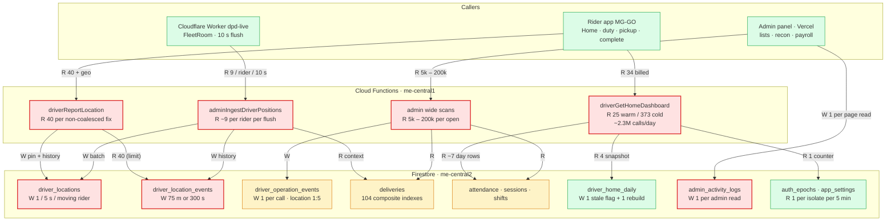
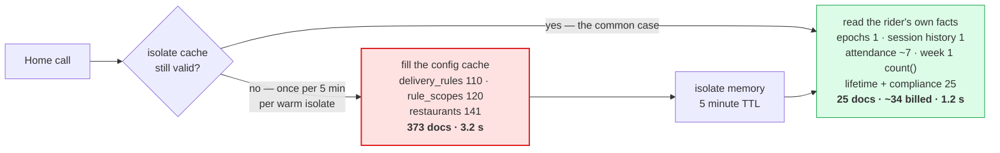
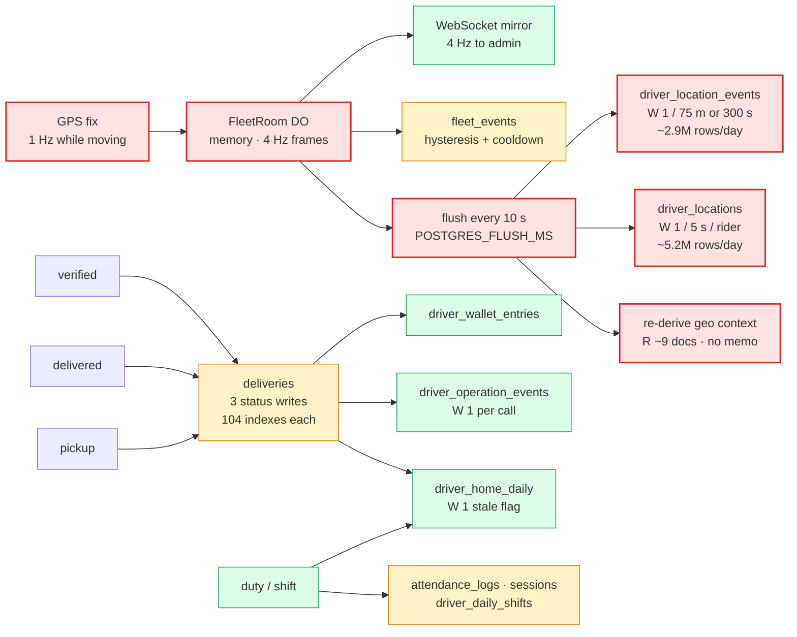
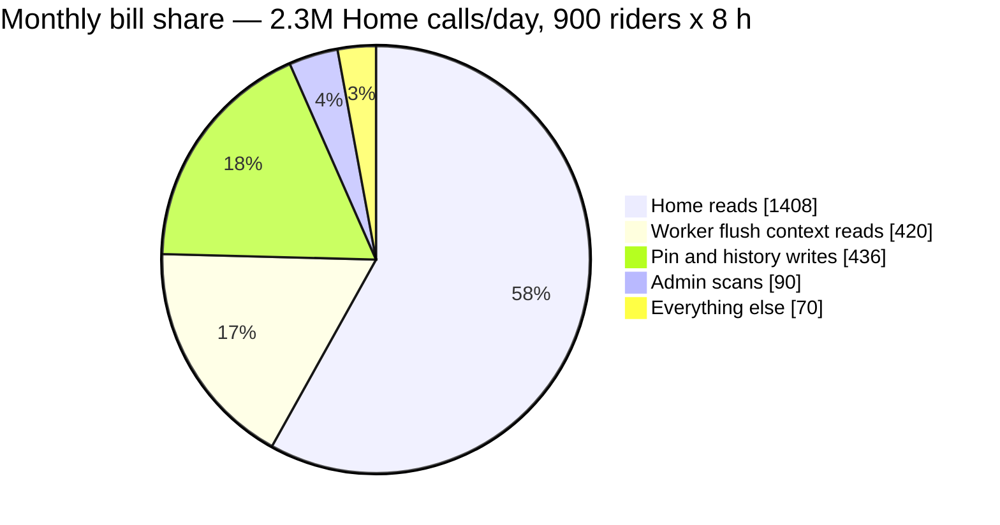

# Firestore read & write hotspot report

**Scope:** `musallam-delivery-prod` — Firestore (`me-central2`), Cloud Functions
(`me-central1`), and the Cloudflare `dpd-live` Worker with its `FleetRoom`
Durable Object. The two callers are the rider app (MG-GO) and the admin panel
(Vercel).

**How to read the numbers.** Anything labelled *measured* came from a deployed
`perf:"handler"` log line, a `count()` aggregate, or the Firebase usage console.
Anything labelled *model* is arithmetic over the constants in the code, and says
so. A cost figure is a **list-price scenario**, never an invoice: only the
billing export can say which line is real. The point of the arithmetic is to
rank the levers, not to predict the bill.

---

## 0. Executive summary

| # | Consumer | Kind | Unit cost | Scale | Fix lever |
|---|---|---|---|---|---|
| 1 | `driverGetHomeDashboard` | read | 25 docs warm / 373 cold, ~34 billed | ~2.3M calls/day | event-driven refresh, not more caching |
| 2 | Worker flush (`adminIngestDriverPositions`) | read | ~9 docs per rider per flush | ~2.6M flush-events/day (model) | memoise the geo context 60 s |
| 3 | Admin wide scans | read | 5k–200k docs per page open | per operator action | precomputed rollups |
| 4 | `driver_locations` pin | write | 1 doc / 5 s / moving rider | ~5.2M rows/day (model) | product decision — do not touch |
| 5 | `driver_location_events` | write | 1 row / 75 m or 300 s | ~3.2k rows/rider/shift (model) | history cadence is its own project |
| 6 | `driverReportLocation` fallback | read | 40 docs to learn 1 row | every non-coalesced fix | `limit(40)` → `limit(1)` |
| 7 | `admin_activity_logs` | write | 1 row per admin page **read** | 81 call sites | sample read logs |
| 8 | `deliveries` composite indexes | storage + latency | 104 of 186 indexes | every delivery write | prune unreachable ones |

Three sentences that decide everything below.

1. **The invoice is reads; the writes are latency.** Reads dominate because a
   cheap call is made millions of times, and because the GPS path re-derives
   context it already knew ten seconds ago. Writes are a fixed product cost
   (a map that glides needs fixes at 1 Hz) and a latency cost (104 indexes on
   one collection), not the line that grows with the bill.
2. **`docsRead` is the bill, `reads` is the latency.** One is documents
   returned; the other is round trips. Optimising the wrong one makes a page
   feel faster and the invoice unchanged.
3. **Every dollar-sized fix is a caching or aggregation fix.** Nothing on this
   list is fixed by a bigger instance, a faster query, or a new index.

---

## 1. How Firestore actually bills

| Operation | Billed per | List price (USD, us-central1) |
|---|---|---|
| Document read | 1 per document returned | $0.06 / 100,000 → **$0.60 per million** |
| Document write | 1 per document written | $0.18 / 100,000 → **$1.80 per million** |
| Document delete | 1 per document deleted | $0.02 / 100,000 |
| Aggregate (`count()`, `sum()`) | 1 per **1,000 index entries** matched | read rate |
| Storage | GiB-month, document + index entries | $0.18 / GiB-month |
| Network egress | bytes leaving the region | first 10 GiB free, then per GiB |

Four consequences that shape the whole map:

* **A query is not a unit of billing.** Six `where` clauses cost what two cost.
  `limit(2000)` matching 500 rows costs 500 reads; matching 2 rows costs 2.
* **Aggregates are almost free, and the local counter lies about them.** Our
  `fs-metrics` wrapper reports `reads: 0` for a `count()` because the runtime's
  `AggregateQuery` class is not the one the patch wraps. Firestore still bills
  roughly one read per aggregate. Counting them honestly is why the Home table
  gives both "documents" and "billed reads".
* **An index entry is not a billed write.** Firestore bills per *document*, so
  104 indexes on `deliveries` do not multiply the write line — they multiply
  storage and the work done inside each write.
* **Cloud Run instance time is billed separately, and it is not small.** With
  `concurrency: 8`, ~27 calls/s of 1.2 s each need roughly four live instances,
  which is ~345,000 instance-seconds/day. At $0.000024 per vCPU-s that is
  ~$250/month of compute for the Home call alone — *before* any documents. The
  fix for that is the same as the fix for reads: fewer calls.

> **Free tier is irrelevant here.** 50,000 reads/day and 20,000 writes/day are
> consumed before the fleet wakes up. Every number below is billed.

### 1.1 Worked arithmetic (the three biggest lines)

```
Home, warm           34 billed reads per call
At 2.3M calls/day    34 × 2.3M            = 78.2M reads/day
Monthly              78.2M × 30           = 2.35B reads
At $0.60/M                                 ≈ $1,408 / month

Worker flush          9 reads per rider per 10 s flush
900 riders × 8 h      900 × 360 × 8       = 2.59M flushes/day
                     × 9                  = 23.3M reads/day
Monthly              23.3M × 30           = 700M reads     ≈ $420 / month

Pin writes            1 write / 5 s / moving rider
900 riders × 8 h      900 × 720 × 8       = 5.18M writes/day
Monthly              5.18M × 30 × $1.80/M ≈ $280 / month

History writes        1 row / 75 m or 300 s ≈ 3.2k rows/rider/shift
                     900 × 3,200          = 2.88M rows/day
Monthly                                    ≈ $156 / month
```

**The two published numbers do not reconcile, and that matters.** The read plan
records ~2.3M Home calls/day *and* a ~1.2B/month read line. At 34 billed reads
per call, 2.3M calls/day is 2.35B/month — roughly double. Either 2.3M is a peak
day, or the 1.2B line predates the snapshot cache, or the average call is
cheaper than a measured warm call. **Pin the real call count from
Cloud Monitoring before quoting any dollar figure**; the ranking survives either
way, the absolute number does not.

### Figure 1 — the whole system in one picture



Red is a primary contributor, amber is bounded but real, green is already
controlled. The shape to notice: **the map's live path (C1, C2) and the
dashboard path (H) are separate systems.** Home is not what makes tracking
expensive, and tracking is not what makes Home expensive. They need different
fixes and they are paid for on different lines.

---

## 2. Read hotspots

### 2.1 `driverGetHomeDashboard` — dominant by volume

Measured after the 2026-10-17 functions deploy: 25 documents, 17 round trips,
1.2 s warm; **373 documents and 3.2 s on a cold isolate**.

| Part | Before | Now | How measured |
|---|---|---|---|
| delivery rules + scopes + restaurants | 371 | **0** (isolate memory) | `count()` |
| incentive scopes / tiers / banners | 0–688 by data | **0** | `count()` |
| rider session history (read twice) | 82 | **1** (`orderBy + limit(1)`) | block log |
| rider attendance day rows (read twice) | 32 | **~7** | block log |
| rider's own week of deliveries | 75 (two scans) | **0 docs** (one `count()`) | block log |
| lifetime counts, compliance, pins, shifts | 25 | **25** (real data) | unchanged |
| **documents per call** | **528** | **25** | handler line |
| **billed reads incl. aggregates** | **528** | **~34** | 25 + 9 aggregates |

The cache did its job: **95% fewer documents, ~94% fewer billed reads.** What it
cannot fix is how often the phone asks. A warm call is cheap; two million warm
calls are the invoice.

**Cold is a different call, and it is paid per isolate per five minutes:**

| Calls per isolate per 5-min window | Average docs per call | vs. before |
|---|---|---|
| 1 | ~373 | 29% |
| 5 | ~95 | 82% |
| 20 | ~43 | 92% |
| 50 | ~32 | 94% |

A busy fleet sits at the bottom row. **Never judge this call from one hand-made
probe** — take the `perf:"handler"` p50 over a busy hour, or simply take the
second call.

**Three things Home must never cache**, because they are the reason the screen
exists and a stale answer is worse than no answer: `drivers.is_on_duty`,
`session.is_online`, and `force_app_update` / `force_app_update_min_code`.
`shift_adherence` and `today_online_seconds` belong to the same list. The
snapshot is for money and history; duty is a fact about now.



### 2.2 The Worker flush — the largest un-cached read

`ingestDriver()` runs per rider per flush (`functions/src/rpcs/fleet-ingest.ts`
L280–290):

```ts
const [assigned, zone, history] = await Promise.all([
  loadAssignedRestaurantContext(args.driverId, args.driver), // junction + restaurants + geofences
  loadDriverZone(zoneId),                                   // 1
  lastHistory(args.driverId),                               // orderBy + limit(1)
]);
```

`loadAssignedRestaurantContext` (`driver-deliveries.ts` L356–396) reads the
`driver_restaurants` junction, then `getAll` on the restaurants, then one
`restaurant_geofences` query per 30-restaurant chunk. For a rider with two
restaurants and three geofences that is **~2 + 2 + 3 + 1 + 1 = 9 documents**, and
**nothing is memoised** — the same rows are re-read for the same rider on the
next flush, ten seconds later.

At the documented model of 900 riders × 8 h and a 10 s flush that is
**~23M context reads/day (~$420/month at list price)** — the second-largest read
line in the system, paid to learn information that changes a few times a week.

The fix is a per-isolate map keyed by driver id with a 60 s TTL, invalidated by
the same restaurant-assignment epoch the Home cache already uses. A rider's
restaurants do not change between two flushes any more often than their zone
does.

### 2.3 `driverReportLocation` — 40 reads to learn one row

`lastHistoryEvent` asks for `limit(40)` and sorts in memory
(`functions/src/rpcs/driver-location.ts` L160–178). It needs the newest row.
`fleet-ingest.ts` already does this correctly at L193–200 with
`orderBy("recorded_at", "desc").limit(1)` — mirroring that is a **40 → 1**
change per non-coalesced fix.

Worse, both `deliveryExists` checks run **before** the coalesce test, so a fix
the server is about to discard still pays for two delivery reads and the full
geo context. Reordering the gate is free: coalescing is decided from the
previous row plus the timestamp, and neither delivery read is an input to it.

### 2.4 Admin wide scans — the operator-triggered spike

Firestore has no server-side aggregation for these lists, so every admin "list"
is a capped scan. The caps are the code's own words:

| Callable | Cap | File |
|---|---|---|
| Order Reconciliation report | 200,000 deliveries | `recon-reports.ts` L38 |
| Recon delivery window | 100,000 | `recon-reports.ts` L37 |
| Recon rows | 50,000 | `recon-reports.ts` L36 |
| Performance list | 60,000 | `performance-list.ts` L32 |
| Performance extra (4 queries) | 60,000 each | `performance-extra.ts` L23 |
| Payroll month | 40,000 | `payroll.ts` L17 |
| Payouts / earnings | 40,000 | `payouts.ts` L43, `earnings.ts` L32 |
| Requests | 10,000 | `requests-core.ts` L47 |
| Attendance window | 5,000 + range refusal | `attendance-ops.ts` L127 |
| Day route events | 20,000 | `day-route.ts` L29 |

One Order Reconciliation open can read more documents than a day of Home
traffic, and it is paid by a single click. In dollars a 100k scan is only
**$0.06**; the reason it tops the list is that operators open these screens
repeatedly and every open also costs 5–25 seconds of wall clock. This is a
**rollup** problem, not a pagination problem: pagination makes the page cheaper
to *render* while still scanning the same rows to compute totals.

### 2.5 Polling and isolate fills

| Caller | Interval | Consequence |
|---|---|---|
| `adminLiveFleetSnapshot` (panel live) | 10 s fallback / 4 Hz edge | one call per open tab, cached base |
| Admin list pages | 30 s TanStack poll | one scan per interval per open page |
| `app_settings` / branding | 60 s, isolate cache 60 s | ~1 read per isolate per minute |
| `auth_epochs/current` | 5 min max TTL | the cache-invalidation counter |
| Home | client timer (today) | **the volume half of the bill** |

Polling is not wrong; polling a *scan* is. The snapshot call is cached and
cheap. The list pages are not.

---

## 3. Write hotspots

| Writer | Rate | Basis |
|---|---|---|
| `driver_locations` | 1 write / 5 s / moving rider | `PIN_WRITE_MIN_MS` 1 s hard cap, `FLUSH_MIN_GAP_MS` 5 s |
| `driver_location_events` | 1 row / 75 m **or** 300 s | `HISTORY_METERS` / `HISTORY_SECONDS` |
| `driver_operation_events` | 1 row per call, `location` sampled 1:5 | `_shared.ts` L210–214, ~74 call sites |
| `admin_activity_logs` | **1 row per admin page read** | `logAdminRead`, 81 call sites today |
| `driver_home_daily` | 1 stale flag + 1 rebuild per change | `driver-home.ts` L1776–1805 |
| `deliveries` | ~3 status writes per order | pickup → delivered → verified |
| Batch mutations | 400 documents per commit | `BATCH_LIMIT` |

### 3.1 The 1 Hz pipeline is a product decision

The map glides because fixes arrive continuously. `PIN_WRITE_MIN_MS` (1 s) and
`FLUSH_MIN_GAP_MS` (5 s) are what keep that from becoming one write per frame
per rider. At 900 riders × 8 h the model is **~5.2M pin rows/day**, and only
the latest row per rider is ever read — the collection is a pin board, not a
history. **Do not trade this for a free-tier number.** The lever that exists is
history cadence, not pin cadence.

### 3.2 History, retention, and what is actually stored

`driver_location_events` keeps one row per 75 m or 300 s while moving, which is
~3.2k rows per rider-shift and ~2.9M rows/day fleet-wide (model). It is the
collection that makes "show me yesterday's route" possible, so it is not
disposable — but retention is configuration, and **the code defaults are not
necessarily what production runs**. Always read the stored `app_settings`
value:

| Stream | Setting | Code default |
|---|---|---|
| `driver_operation_events` | `driver_ops_log_retention_days` | 30 days |
| `driver_location_events` | `driver_location_events_retention_days` | 90 days |
| `driver_telemetry_events` | `driver_telemetry_retention_days` | 7 days |

Each row kept is a row every later purge pass must read and delete, so a wide
window is a permanent read + write cost, not only storage.

### 3.3 Audit and event streams

`driver_operation_events` logs one row per state-changing RPC, with the
`location` module sampled 1-in-5 (`_shared.ts` L210–214) because it is by far
the highest-frequency call. `fleet_events` carries edge-derived events with
hysteresis and cooldowns, so a rider parked on a zone boundary cannot generate
one row per sample.

`admin_activity_logs` is the odd one: **reading an admin page is a write.** The
earlier hotspot map counted 43 read call sites; the tree has **81 today
(`rg -o "logAdminRead\\(" src | wc -l`)**, because more modules have landed
since. In dollars this line is small — 81 sites at a few thousand page views a
day is cents — but it is the wrong shape: it grows with *supervision*, and it
puts a write on the read path of every screen. Sample it, or keep only exports
and decisions.

### 3.4 Fan-out writes

Notification dispatch writes one `notification_dispatch_items` row per
recipient, then upserts `notification_analytics_daily/{day}_{campaignId}` on
each delivery / open / click / failure. A campaign to 900 riders is ~900 writes
plus a handful of counter updates — correct, but it means **campaign size is a
write multiplier**, not a read one. Batch mutations cap at 400 documents per
commit for the same reason: beyond that, a single write becomes several.

Snapshot invalidation is deliberately the cheap direction: writers set one
`stale: true` flag and the next Home call rebuilds (35 reads + 1 write), instead
of every writer rebuilding the snapshot inline.



---

## 4. Indexes — 186 composite, 104 on `deliveries`

| Collection | Indexes | Note |
|---|---|---|
| `deliveries` | **104** | 56% of the file; prefix/search + status/zone/partner/date filters |
| `admin_activity_logs` | 9 | append-only; read-side filters |
| `driver_operation_events` | 8 | sliding-window queries |
| `fleet_events` | 8 | edge-derived events |
| `notification_dispatch_items` | 7 | per-recipient status |
| `driver_telemetry_events` | 7 | 14-day retention |
| `attendance_logs` | 6 | date pages |
| `driver_location_events` | 6 | last-event + day route |
| `notification_campaigns` | 4 | list filters |
| 23 other collections | 24 | 1–3 each |
| **Total** | **186** | verified by counting `firestore.indexes.json` |

**What they cost:** storage (every index entry is stored and billed as
GiB-month) and **write latency** (a delivery status change rewrites every index
entry whose fields appear in that document, and `deliveries` is written about
three times per order). **What they do not cost:** billed document writes.
Firestore bills per document, not per index entry. So this is a latency and
storage problem wearing a bill's clothing.

Three traps already paid for in this repo:

* **A missing composite means a full scan.** On 2026-10-02 the deliveries list
  re-read 114 MB to return 50 rows because `created_at` had no index.
* **A sort direction that does not match the query is never used.** PostgREST
  emits `ORDER BY created_at DESC NULLS LAST`; a plain `DESC` btree is
  `NULLS FIRST`, so the planner refused it and kept the sequential scan.
* **A cap is not a bound on work.** `limit()` bounds the payload, not the rows
  examined for an aggregate or a sort.

Before adding an index for a filter, ask whether the number can come from a
rollup (`driver_performance_daily`, `rollups_driver_day`). A rollup is one
document read; an index only makes the scan faster.

---

## 5. Why it gets slow — symptoms and causes

| Symptom | Usual cause | First check |
|---|---|---|
| One screen takes 3 s, the next is instant | cold isolate paying the config fill | 373 vs 25 in `perf:"handler"` |
| Everything is uniformly slower | region hop (functions `me-central1` ↔ Firestore `me-central2`) | compare `ms` across unrelated callables |
| p50 reads flat, p50 `ms` rising | sequential awaits / round trips, not payload | `perf:"block"` entries with `docsRead` 0 |
| A list page takes 10–25 s | wide scan, and possibly a missing index | the cap for that callable vs rows returned |
| Writes slow down as history grows | index fan-out on `deliveries` | number of writes per order |
| Map pin freezes, then jumps | ingest coalesced too aggressively, or edge rail down | `coalesced: true` rate, transport pill |
| Live tracking empty after a deploy | Worker over quota / 1027 | Worker + DO requests for the day |
| "No records" where records exist | a cap threw (`too_many_rows`, `range_too_large`) | the callable's cap and the error key |

### 5.1 Cold start is a document problem, not a CPU problem

A cold Home isolate reads 373 documents and takes ~3.2 s; a warm one reads 25
and takes ~1.2 s. Most of that difference is document fetches, not boot time,
which is why the snapshot design targets "cold fill ~373 → ~47" rather than
"give it more CPU". Creating a second callable to "warm" the cache costs the
same reads and adds a bill; the snapshot is the answer.

### 5.2 Sequential round trips are the invisible latency

The block logs show steps at `ms: 0` with `docsRead: 0` — those are not free,
they are round trips that returned no documents. Eight sequential fleet-wide
reads becoming one counter read is a latency fix that does not move the read
line at all, and both must be measured separately or the "optimisation" looks
like a regression.

### 5.3 The region hop is a constant tax

Functions run in `me-central1` (Doha), Firestore data lives in `me-central2`
(Dammam). Every hop is a cross-region call. It is small and unavoidable here
(the earlier Supabase estate paid ~85–105 ms per hop across an ocean), but it is
why a call with four round trips cannot beat one with one round trip, regardless
of payload.

### 5.4 When the cap becomes the bug

`adminListAttendanceDaily` refuses above 5,000 rows with
`attendance_window_too_large`, and the panel renders that sentence as the empty
state instead of "no data". `recon-reports` throws `range_too_large` above its
cap; `performance-list` throws at 60k. These are correct guards — a silently
truncated report is worse — but they are also **performance drops that look like
data loss**. Any new cap must ship with copy that says which one fired.

### 5.5 The edge has a hard ceiling

Measured 16–17 Aug: **157,616 requests/day against a 100,000 free-plan
ceiling** — 61% Durable Object, 39% Worker. The 2 s room tick alone is 43,200
requests/day, **43% of the quota, burnt whether or not anyone is on duty**. The
free plan answers 1027 and the WebSocket closes 1006; the page falls back to the
poll rail, which is *more* Firestore reads. Workers Paid costs about
**$5.60/month** for this fleet at measured volume, which is cheaper than the
fallback it prevents.

### 5.6 Cloud Run queueing

Per-function options are deliberately small: Home is `cpu 1 / 1 GiB /
concurrency 8 / maxInstances 20`, while duty writes run `concurrency 1`. At
peak, a `concurrency: 1` callable queues behind itself — the symptom is a slow
clock-in, not a slow query. Raising concurrency is only safe when the handler
is stateless across invocations; ours are not all.

---

## 6. What the bill looks like, and which lever moves it

### Figure 4 — estimated monthly share (scenario, list price)



| Lever | Affects | Expected effect | Confidence |
|---|---|---|---|
| Home → event-driven refresh | call volume | 60–80% of Home reads | high — design already coded |
| Ingest context memo (60 s) | docs per flush | ~80% of context reads | high |
| `limit(40)` → `limit(1)` + reorder gate | docs per fix | ~88% of that call's reads | high, one-line change |
| Rollups for recon / performance / payroll | scans per open | 100k → <100 docs | medium — new writers required |
| Sample `logAdminRead` (1:10) | audit writes | 90% of that line | high |
| Prune unreachable `deliveries` indexes | write latency | not billed; felt on verify | medium — measure first |
| Shorten location retention 90 → 30 d | storage + purge reads | ~66% of that collection | **needs compliance sign-off** |

> **Do not buy your way out.** A larger instance shortens a scan; it does not
> reduce documents read. The only levers that move the invoice are **fewer
> calls, fewer documents per call, and precomputed answers**.

---

## 7. What not to do

1. **Do not cache duty state.** `is_on_duty`, `is_online`, force-update flags
   and shift adherence are facts about *now*. A rider who clocks out and still
   sees "On" will call support.
2. **Do not raise a scan cap.** It converts a caught error into a 25-second
   page and a bigger bill. Replace the scan.
3. **Do not delete history for storage.** Route history and audit trails are
   the product. Change retention with a written decision, not in a perf pass.
4. **Do not shard the FleetRoom.** Measured: 500 riders at 1 Hz sits at **37% of
   the room's per-second budget** (p50 239 ms, p95 374 ms). Sharding is
   contingency, not optimisation.
5. **Do not add an index per query.** 104 already sit on `deliveries`; each one
   is paid on every write. Check for a rollup first.
6. **Do not turn off `PERF_METRICS`.** The `perf:"handler"` line is the only
   per-request read count that exists. Turning it off makes every claim in this
   document unverifiable.
7. **Do not trust one probe.** A cold first call is 373 documents; a warm second
   is 25. Take p50 over a busy hour.

---

## 8. How to measure (the procedure these numbers come from)

1. **Call twice, record both.** The first call fills the isolate; the second is
   steady state.
2. **Cloud Logging, p50 and p95 — not the mean.**

   ```
   resource.type="cloud_function"
   jsonPayload.perf="handler"
   jsonPayload.name="driverGetHomeDashboard"
   ```

3. **Split the call by block.**

   ```
   resource.type="cloud_function"
   jsonPayload.perf="block"
   jsonPayload.name=~"home\\..*"
   ```

   On the pre-cache code the largest entries were `home.deliveryRules` and
   `home.incentiveRules`; warm, both are zero.
4. **Reads/day from the console**, same hour as the previous day — reads track
   duty state, not the clock.
5. **Never read `reads` as the bill.** `reads` is round trips; `docsRead` is
   documents.
6. **Fleet-wide counts**, read-only, no rider identity printed:

   ```
   node --import tsx scripts/measure-firestore-amplification.mts
   ```

7. **After every phase, re-run 1–4 at the same time of day.** A percentage with
   no before/after line is an opinion.

---

## 9. Priority order

| Phase | Change | Why first | Verification |
|---|---|---|---|
| 1 | `limit(40)` → `limit(1)`; move `deliveryExists` after coalesce | smallest diff, largest per-call reduction | `docsRead` on one fix: 40+ → ~3 |
| 2 | Memoise ingest geo context 60 s | second-largest read line, no schema change | `docsRead` per flush: 9 → ~1 |
| 3 | Ship Home snapshot + `record_type: 'home'` refresh | removes the volume half, not the doc half | calls/rider/day in Monitoring |
| 4 | Rollups for recon / performance / payroll / payouts | protects the operator path | rows read per open |
| 5 | Sample `logAdminRead`; prune dead `deliveries` indexes | housekeeping with latency upside | writes/day, verify-queue p95 |
| 6 | History cadence / retention review | the only remaining write lever | rows/day, storage GiB |

Phases 1 and 2 are one afternoon each and together remove the majority of the
non-Home read line. Phase 3 is an app release. Phase 4 is the only one that
needs new writers, and it is the only one that makes the admin panel fast.

---

## 10. Appendix — constants and sources

| Constant | Value | Where |
|---|---|---|
| Pin write floor | 1 s hard cap, 5 s flush gap | `fleet-ingest-rules.ts` L100–104, `fleet-room.ts` L89 |
| History cadence | 75 m or 300 s | `driver-location.ts` L25–26 |
| Batch commit limit | 400 documents | `_shared.ts` L19 |
| `in` filter chunk | 30 ids | `_shared.ts` L21 |
| Default scan cap | 2,000 | `_shared.ts` L23 |
| Worker flush | 10 s | `infra/workers/dpd-live/wrangler.jsonc` L29 |
| Room tick | 2,000 ms | `fleet-room.ts` (`TICK_MS`) |
| Room frame rate | 4 Hz | `POSITION_FRAME_HZ` |
| Retention defaults | 30 / 90 / 7 days | `functions/src/rpcs/retention.ts` L157–177 |

**Companion documents:** `firestore-hotspots.md` (the ranking this report
expands), `firestore-cost-baseline.md` (how to measure),
`firestore-read-reduction-plan.md` and `firestore-home-read-plan.md` (the Home
phases), `platform-load-map.md` (Firebase, Supabase and Cloudflare side by
side), `firestore-billing-explained.md` (pricing mechanics).

**What this report does not claim.** It does not claim the invoice equals the
scenario table, that the 2.3M call figure and the 1.2B read line reconcile, or
that any dashboard number here is current to the minute. It claims the ranking
is stable, and that each per-call number has a file and a log line behind it.
