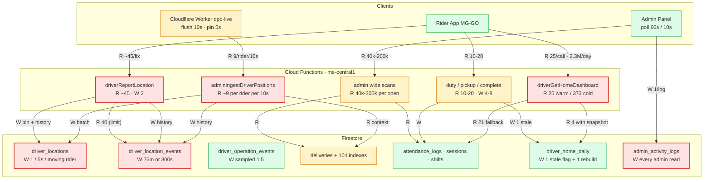

# Firestore hotspot map — reads, writes, indexes

Where the bill actually comes from, by module. Companion to
[platform-load-map.md](./platform-load-map.md) (the same picture across Firebase,
Supabase and Cloudflare, with the four diagrams),
[firestore-read-reduction-plan.md](./firestore-read-reduction-plan.md) (Home),
[firestore-billing-explained.md](./firestore-billing-explained.md) and
[firestore-cost-baseline.md](./firestore-cost-baseline.md).

This file is a **map**, not a plan: it ranks the consumers and says which file
proves each number. Every figure marked *measured* came from the docs above or a
`perf` handler log; every figure marked *model* is arithmetic on the constants
in the code and says so.

## 1. Ranking

| # | Consumer | Kind | Cost driver | Evidence |
|---|---|---|---|---|
| 1 | `driverGetHomeDashboard` | R | 25 warm docs (~34 billed with aggregates), 373 cold, ~2.3M calls/day | `functions/src/rpcs/driver-home.ts` L1610–1700, read-reduction-plan §1 |
| 2 | Worker ingest (`adminIngestDriverPositions`) | R+W | per rider per 10 s flush: junction + restaurants + geofences + zone + last history + settings | `functions/src/rpcs/fleet-ingest.ts` L280–290, L490–508; `wrangler.jsonc` L29 |
| 3 | `driverReportLocation` (edge fallback) | R+W | `limit(40)` history query + 2 delivery reads + geo context on every non-coalesced fix | `functions/src/rpcs/driver-location.ts` L160–178, L228–234 |
| 4 | Admin wide scans | R | `performance` 60k, `recon` 50k/100k/200k, payroll/payouts/earnings 40k per open | `performance-list.ts` L32, `recon-reports.ts` L36–38, `payouts.ts` L43, `payroll.ts` L17 |
| 5 | `driver_locations` pin | W | one write per 5 s per moving rider | `fleet-ingest-rules.ts` L100–104, `fleet-room.ts` L89 |
| 6 | `driver_location_events` history | W | one row per 75 m or 300 s while moving | `driver-location.ts` L25–26 |
| 7 | `admin_activity_logs` | W | one write **per admin page read** (43 read call sites) | `src/lib/audit/log-admin-activity.ts`, `functions/src/rpcs/_shared.ts` L184 |
| 8 | `deliveries` composite indexes | storage/write latency | 104 of 186 composite indexes on one collection | `firestore.indexes.json` |
| 9 | `driver_operation_events` / `fleet_events` | W | append-only audit, location sampled 1:5 | `_shared.ts` L210–214 |
| 10 | Notification fan-out | W | one `dispatch_items` row per recipient + analytics upsert per event | `notifications` RPCs |

Reads are dominated by **call volume on a cheap call** (1) and by **un-cached
geo context on the GPS path** (2, 3). Writes are dominated by the **1 Hz
pipeline** (5, 6), which is a product decision, not a bug.

## 2. Relationship diagram

## 3. Reads — what to look at first

**1. Home (dominant by volume).** 25 documents per warm call is cheap; 2.3M
calls/day is not. The snapshot path (`driver_home_daily`) is coded and behind
`app_settings.home_snapshot_enabled`; its declared runtime is
`cpu 1 / 1GiB / concurrency 8 / maxInstances 20` (`driver-home.ts` L1943), which
converts a 373-document cold fill into ~47 per call. What is still missing is the
**call volume** half: refresh on FCM `record_type: home` plus one watcher on
`drivers/{uid}` (read-reduction-plan §4 step 1). Until the app release ships,
reads stay volume-bound no matter how few documents the call returns.

**2. Worker ingest (the hidden one).** Every 10 s flush re-derives the rider's
geo context from source: `driver_restaurants`, `restaurants`,
`restaurant_geofences`, the zone doc, `app_settings` and a 1-document
`driver_location_events` lookup (`fleet-ingest.ts` L280–290). A rider with two
restaurants and three geofences therefore costs ~9 reads per flush, six flushes
a minute. There is no memo: the same rows are re-read for every rider, every
flush. Memoising the context per driver for 60 s (or pushing it into the room at
`hello`) is the single largest read win left on the GPS path.

**3. `driverReportLocation` fallback.** `lastHistoryEvent` asks for
`limit(40)` and sorts in memory (`driver-location.ts` L160–178) — 40 reads to
learn one row, on a path that also reads two `deliveries` docs and the full geo
context. `fleet-ingest.ts` already does this correctly with
`orderBy("recorded_at", "desc").limit(1)` (L193–200); mirroring that is a
40 → 1 change. Note the two `deliveryExists` reads happen **before** the
coalesce check, so even a suppressed fix pays them.

**4. Admin scans.** Firestore has no SQL aggregation, so every admin "list" is a
capped scan: `performance-list` 60k, `performance-extra` 4 × 60k,
`recon-reports` 50k/100k/200k, payroll/payouts/earnings 40k each, e-sign 20k,
requests 10k. One open of Order Reconciliation can read more than a day of Home
traffic. These need precomputed rollups (the `driver_performance_daily` /
`rollups_driver_day` pattern), not smaller pages.

## 4. Writes — the tier no read fix reaches

* `driver_locations`: one write per 5 s per moving rider
  (`PIN_WRITE_MIN_MS`, `FLUSH_MIN_GAP_MS`). At 900 riders × 8 h that is ~5.2M
  rows/day. **Model, not measured** — it scales with on-shift hours and speed.
* `driver_location_events`: one row per 75 m **or** 300 s while moving
  (`HISTORY_METERS` / `HISTORY_SECONDS`). At 30 km/h a rider writes ~3.2k rows
  in an 8 h shift. **Model.**
* `driver_operation_events`: location is sampled 1-in-5, every other module 1:1
  across ~74 call sites (`_shared.ts` L210–214). Retention is the other lever;
  check the **stored** `app_settings` values, not the code defaults.
* `admin_activity_logs`: `logAdminRead` runs on 43 read paths, so *viewing* a
  page is a write. There are also 9 composite indexes on this append-only
  collection. Sampling read logs (or logging only exports / decisions) removes a
  write that carries no security value at 1:1.
* Snapshot invalidation is deliberately cheap: writers write one `stale: true`
  flag, and the next Home call rebuilds (35 reads + 1 write)
  (`driver-home.ts` L1776–1805).

## 5. Indexes

186 composite indexes, **104 on `deliveries`** — 56% of the whole file. They are
the prefix/search and status/zone/partner filters added for the deliveries list.
Composite index entries cost storage, and every delivery write updates every
index whose fields appear in the document, which is write latency on the hot
status path (`in_transit` → `pending` → `verified`). Billed *document writes* do
not change — Firestore bills per document, not per index entry — so this is a
storage and latency problem, not a read problem.

Next largest: `admin_activity_logs` 9, `driver_operation_events` 8,
`fleet_events` 8, `driver_telemetry_events` 7, `notification_dispatch_items` 7,
`driver_location_events` 6, `attendance_logs` 6.

Rules of thumb that already hold here: an admin read that has no composite index
degrades to a full scan (the 2026-10-02 `deliveries` entry), and an index whose
predicate does not match the query shape is never used (`NULLS LAST`). Before
adding one for a filter, check whether the same result can come from a rollup.

## 6. Highest-leverage fixes, in order

1. **Memoise ingest geo context** per driver (60 s TTL or room-side) — cuts the
   largest un-cached read on the write path.
2. **`limit(40)` → `orderBy('recorded_at','desc').limit(1)`** in
   `driverReportLocation`; move `deliveryExists` after the coalesce check.
3. **Ship the Home snapshot + event-driven refresh** (already coded, flagged) —
   4 docs per call and single-digit calls per rider per day.
4. **Replace admin wide scans with rollups** for `performance`, `recon`,
   `payroll` and `payouts`.
5. **Sample `logAdminRead`** and prune unreachable `deliveries` indexes.
6. **Writes:** accept the 1 Hz bill or treat history cadence as a separate Live
   Tracking project. Do not trade tracking fidelity for a free-tier number.
