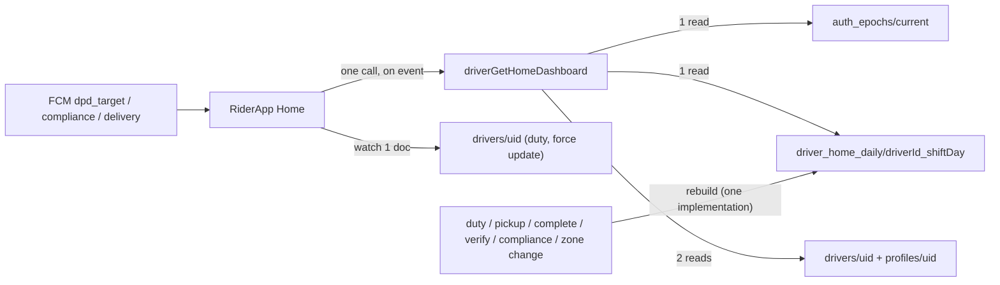

# Home dashboard read reduction — plan (write-tier + cents)

Companion to [firestore-cost-reduction.md](./firestore-cost-reduction.md) (what
shipped), [firestore-billing-explained.md](./firestore-billing-explained.md)
(how billing works) and [firestore-cost-baseline.md](./firestore-cost-baseline.md)
(how to measure). This file is the **next** phase.

## 1. Where we are

| Metric | Value |
|---|---|
| `driverGetHomeDashboard` before Phase 1–2 | 528 documents/call |
| Warm call today (deployed) | 25 documents, ~34 billed reads (9 aggregates) |
| Cold call (isolate fill) | ~373 documents |
| Production read line | ~1.2B reads (limit exceeded by 1.2B) |
| Production write line | ~2M (limit 40K/day) |
| Real-time read line | 1.7K of 50K — unused, and not transferable |

Already done and deployed: isolate config cache
([`functions/src/core/config-cache.ts`](../../functions/src/core/config-cache.ts)),
config epoch invalidation, `count()` / `sum()` aggregates, bounded per-rider
queries, Node 22, four composite indexes verified READY.

What is left is **call volume** (a rider's phone calls this function far more
often than the data changes) and **the residual 25 documents**, which are real
per-rider rows re-read on every call.

## 2. Hard constraints — do not change these

* **Live Tracking is out of scope.** The admin map reads the Worker Durable
  Object and `driver_locations`; it never calls Home. Do not slow
  `POSTGRES_FLUSH_MS` / `FLUSH_MIN_GAP_MS`
  ([`infra/workers/dpd-live/wrangler.jsonc`](../../infra/workers/dpd-live/wrangler.jsonc),
  [`fleet-room.ts`](../../infra/workers/dpd-live/src/fleet-room.ts)).
* **Never cache or defer:** `drivers.is_on_duty`, `session.is_online`,
  `force_app_update` / `force_app_update_min_code`, `shift_adherence`,
  `today_online_seconds`.
* **Money is server-side.** `daily_dpd` / `daily_dpd_targets`, `progress_count`
  vs `eligible_count`, and payout math stay computed from source in the RPCs.
  The Home card is a display of those numbers, never the source of truth.
* **DPD counters are shift-day based** (`deliveries.shift_date`, migration
  `20261109000000`). Any new day key uses `shiftDate`, not the calendar day.
* **Write-path first, then read-path.** A snapshot document with a missing
  writer silently undercounts (the reason `rollups_driver_day` is not used for
  the week count today).

## 3. Target architecture



Reads per call: **4 documents** (was 25), and calls per rider per day drop from
dozens to single digits.

## 4. Work items, in sequence

### Step 1 — event-driven refresh (app + push, no new tables)

**Server (this repo).** The push envelopes already exist and carry
`action_params.record_type` = `dpd_target` | `compliance` | `delivery` | `esign`
| `visit` | `appointment` (see [`docs/DRIVER_APP_HANDOFF.md`](../DRIVER_APP_HANDOFF.md) §563,
§595). Add `record_type: 'home'` to the duty-state writes that change what Home
shows but currently notify nothing: server auto-checkout (`applyRiderCheckout`),
`set_driver_blocked`, inactive-status clock-out, and the admin duty correction.
Send it data-only (no tray item), so it is a refresh signal, not a message.

**App (MG-GO, separate repo, Play release).**

* Remove the periodic Home refresh. Refresh on: app open/resume, clock-in/out,
  pickup/complete, and an FCM `record_type` in
  `{home, dpd_target, compliance, delivery}`.
* Keep a **single realtime watcher on `drivers/{uid}`** (`is_on_duty`,
  `force_app_update*`, `zone_id`, `partner_id`). Without this, a server-side
  auto-checkout leaves the toggle showing **In** and the rider taps a dead
  Deliver button — the exact failure class the 2026-08-17 duty-refusal work
  fixed.
* Do not remove polling silently: gate it behind a remote flag
  (`app_settings`) so a bad release can be reverted without Play.

Acceptance: Home refreshes at least once per duty transition and once per
silent push; a duty auto-checkout is reflected within one watcher event.

### Step 2 — client payload cache + epoch

**Server.** Add `config_epoch` and `server_day` (Kuwait) to the Home payload so
the client can invalidate on a rule/banner edit and roll over at midnight,
without a second call.

**App.**

* Cache the payload for 5–15 minutes, keyed on `uid` + `server_day` +
  `config_epoch`; `shift_adherence`, `is_on_duty`, `is_online`,
  `today_online_seconds` and `force_app_update*` are read from the watcher /
  fresh call only.
* Key on the **shift day** as well as the Kuwait day, so a rider opening the app
  at 01:00 does not see the previous day's counters.

Acceptance: an unchanged payload costs 0 reads on the second open within the
window; a rule edit in the panel (bumps `auth_epochs/current.config`) is visible
on the next open, not after cache + TTL.

### Step 3 — one snapshot document (the biggest per-call win)

New collection `driver_home_daily/{driverId}_{shiftDate}`:

```
week: { deliveries_count, online_seconds, earnings_kwd,
        invalid_days, rejected_orders, cancelled_orders }
performance: { total, verified, pending, in_transit, rejected, cancelled }
session: { is_online, went_online_at, speed_mps, distance_today_meters,
           elapsed_seconds_base, open_since }
shift: { adherence block }
targets: { daily_dpd, daily_dpd_targets[] }   // optional, see below
updated_at, version, shift_date
```

Rules that make this safe (each one is a past incident):

* **One implementation, many callers.** `rebuildDriverHomeDaily(driverId, day,
  reason)` is idempotent and recomputes the whole doc from source. Call it from
  every writer: duty state / checkout, `driverCreatePickup`,
  `driverCompleteDelivery`, cancel, admin verify + bulk status, compliance
  upload, earnings recalc, driver zone/partner change. Do **not** hand-increment
  fields from each writer — that is how a rollup goes wrong.
* **`today_online_seconds` = `elapsed_base + (now - open_since)`.** Store the
  base and the open instant; the client adds the elapsed part. Reconcile at
  checkout. Two writers must not both add the same seconds.
* **Staleness fallback.** If the doc is missing, `version` mismatches, or
  `updated_at` is older than N minutes (start with 30), the RPC recomputes via
  today's 25-document path. A repair cron (hourly, Kuwait day) rebuilds any doc
  missing or stale. Without this, one missed writer is wrong until midnight.
* **Day key is `shift_date`.** Compliance rows are keyed on the Kuwait day;
  translate explicitly rather than assuming they agree.
* **Zone reassignment is an admin write**, not a rider action — include it in
  the rebuild callers or the rider sees another zone's target.

Expected per call after this step: `drivers` + `profiles` + `auth_epochs` +
snapshot = **4 documents** (~5 billed with the `count()` fallback retired).

Keep the current code path behind a flag (`app_settings.home_snapshot_enabled`)
for a week of parallel comparison: the RPC returns both, the client uses the
snapshot, and a log line records any mismatch. Only then retire the old path.

### Step 4 — give the callable its own runtime options

Today `driverGetHomeDashboard` inherits `setGlobalOptions({cpu: 0.08,
concurrency: 1, maxInstances: 2, memory: 256MiB})`
([`functions/src/core/init.ts`](../../functions/src/core/init.ts)), so **every
rider gets a private isolate and pays the 373-document cold fill**. The lane
router is not open to it: `isDriverAppCallable()` excludes every `driver*` name
([`functions/src/router/lanes.ts`](../../functions/src/router/lanes.ts) L118),
and moving it to `adminApi` would require the rider app to call
`{fn, data}`, i.e. an app release and a timeout change.

Preferred (no app change):

* Add an options parameter to
  [`measureOnCall`](../../functions/src/core/fs-metrics.ts) L223 and give
  `driverGetHomeDashboard` (and `driverSetDutyState`) their own
  `{ region, cpu: 1, memory: "1GiB", concurrency: 8, maxInstances: 20 }`.
  `driverGetHomeDashboard` is read-only, so concurrency is safe; 8 calls then
  share one config cache, turning the 373-document fill into ~47 per call.
* Size `maxInstances` for the shift-start herd (08:00), not the average: 8
  concurrent × 20 instances = 160 in flight.
* Add a per-read timeout so one hung Firestore call cannot block 8 riders.

Alternative (only if the app release is acceptable): a rider lane export that
routes `driver*` names the same way `adminApi` routes admin names.

### Step 5 — writes (the tier that no read fix reaches)

Free tier is 40K writes/day = 44 per rider. The live pipeline alone is a row
per 5 s per moving rider. Order of work:

1. Measure writes per collection for one day (Firestore usage graph + the
   `perf` logs) before touching anything.
2. `driver_operation_events`: keep sampling `location` (already 1-in-5,
   [`_shared.ts`](../../functions/src/rpcs/_shared.ts)); extend sampling to any
   other high-frequency module, failures always 1:1.
3. Retention: check the stored `app_settings` values are actually the tightened
   defaults (30 / 90 / 7,
   [`retention.ts`](../../functions/src/rpcs/retention.ts) L52). A stored old
   value wins over the code default.
4. `driver_locations`: the only large lever is flush cadence, and that is a
   **Live Tracking** trade. Do not change it as part of a read programme.
5. State honestly to the owner: reads can reach the free tier; writes cannot
   while 1 Hz tracking lands in Firestore. The write bill is a design choice,
   not a bug to optimise away.

## 5. Feature impact

| Feature | Impact | Required guard |
|---|---|---|
| Admin Live Tracking (map/trail/playback) | none | do not touch the flush cadence |
| Home: DPD target / zone target / partner card | reflects the target within minutes instead of seconds | snapshot keyed on shift day; rebuild on zone change |
| Weekly incentive / earnings card | same lag; must not disagree with Earnings tab | rebuild after earnings recalc |
| Compliance counts | lag until push | rebuild on compliance upload |
| Duty toggle, shift-end auto checkout, 45-min zone timer | **regresses if polling is removed without the `drivers/{uid}` watcher** | watcher required in step 1 |
| Blocked / force update | display lag only; no write bypass | exclude from client cache |
| Attendance / payroll correctness | none — server RPCs untouched | — |
| Admin Activity audit | `location` module sampled | keep money/duty 1:1 |

## 6. Measurement gates

Do not claim a step until its line moves in Cloud Logging:

```
jsonPayload.perf="handler" jsonPayload.name="driverGetHomeDashboard"
```

| After | Expected `docsRead` p50 (warm) |
|---|---|
| today | 25 |
| step 1 + 2 | 25 per *call*, but calls/rider/day down to single digits |
| step 3 | 4–5 |
| step 4 | cold fill 373 → ~47 average |

Also record Firestore usage (reads/day, writes/day) for the same weekday before
and after, and `scripts/measure-firestore-amplification.mts` for the fleet-wide
counts.

## 7. Rollout order and rollback

1. Step 4 (server only, no behaviour change) — deploy, verify the cold-fill drop.
2. Step 1 server half (new `record_type: 'home'` pushes) — deploy alone; old app
   builds ignore an unknown `record_type`.
3. Step 1 + 2 app release behind a remote flag — Play.
4. Step 3 behind `home_snapshot_enabled`, shadow-compare for a week, then flip.
5. Step 5 after a per-collection write measurement.

Rollback for every step: the remote flag for the app, `home_snapshot_enabled`
for the RPC, and a single-target function deploy for the rest. No schema
migration and no data migration is required by any step.

## 8. Open decisions

* **Snapshot collection name.** `driver_home_daily/{driverId}_{shiftDate}` vs
  reusing `rollups_driver_day`. Recommendation: new collection — the rollup's
  writer set is already incomplete and its semantics are order counts, not Home.
* **Who pays the first response.** If `driverGetHomeDashboard` must stay under a
  fixed latency budget, the snapshot rebuild can run inside the same call on a
  cache miss (one extra write per miss). Confirm this is acceptable.
* **Write tier target.** Confirm the owner accepts the write bill, or wants a
  Live Tracking history reduction (flush cadence) as a separate project.
