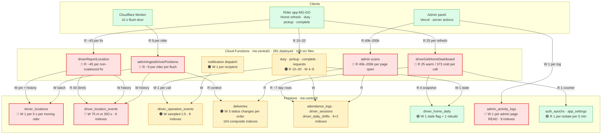
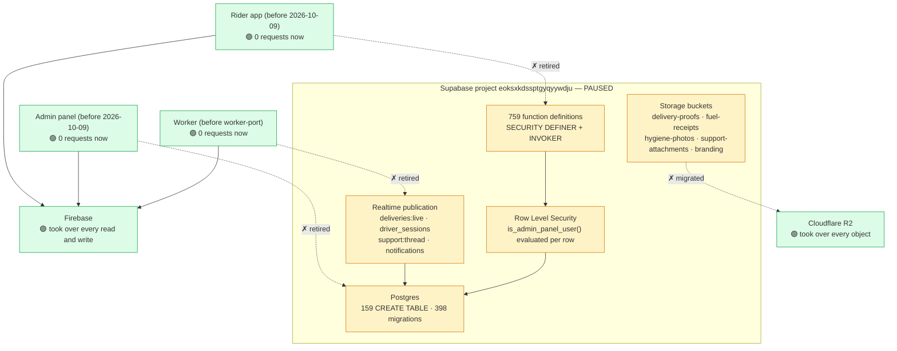
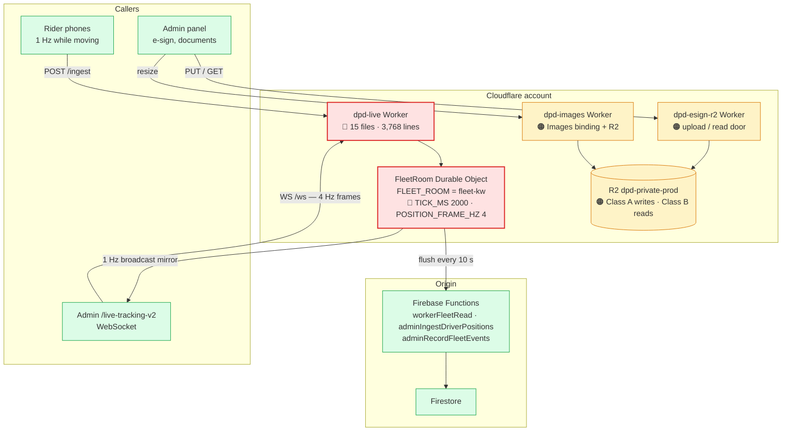
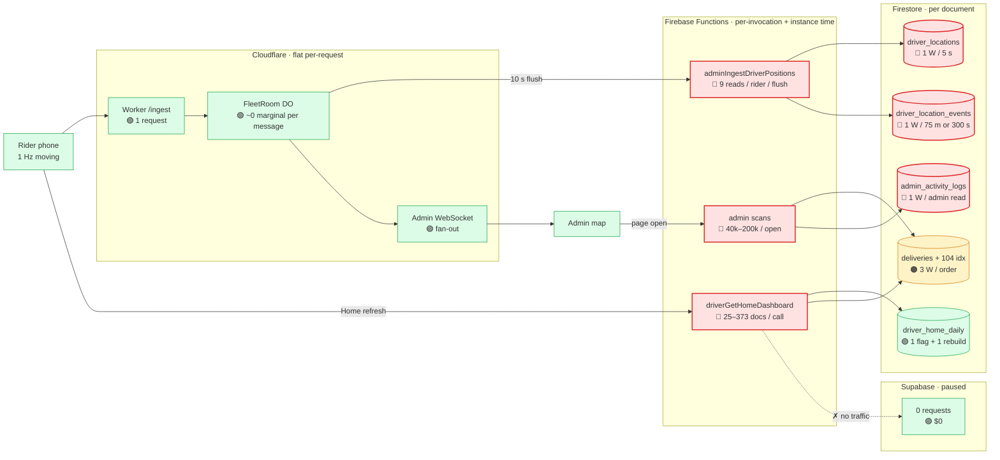

# Platform load & cost map — Firebase · Supabase · Cloudflare

**Purpose:** one document that keeps the hotspot diagram, states what each layer
costs and why, records the *measured* numbers with their source file, and names
what a performance drop on each layer looks like.

**Read this first:** Firestore bills **per document returned**, not per query. A
`limit(2000)` query matching 500 rows costs 500 reads; six `where` clauses cost
the same as two. `count()` / `sum()` bill **1 read per 1,000 index entries
matched**. Writes bill at roughly **3–6× the read rate**. That single asymmetry is
why this map separates "cheap call, high volume" from "expensive call, low
volume" — they need opposite fixes.

Companions: [firestore-billing-explained.md](./firestore-billing-explained.md) ·
[firestore-cost-baseline.md](./firestore-cost-baseline.md) ·
[firestore-read-reduction-plan.md](./firestore-read-reduction-plan.md) ·
[firestore-hotspots.md](./firestore-hotspots.md)

---

## 0. The three layers in one line each

| Layer | Role today | Billed by | Biggest line |
|---|---|---|---|
| **Firebase** (Firestore + Functions, `musallam-delivery-prod`) | Source of truth for every rider, delivery, shift, money row; compute for all 281 callables | documents read / written / stored, Cloud Run instance-seconds | document reads |
| **Supabase** (`eoksxkdssptgyqyywdju`) | **Paused.** No admin or Worker call reaches it; 0 imports in `src/` | nothing while paused | — (historically: Postgres DB time + egress) |
| **Cloudflare** (`dpd-live`, `dpd-images`, `dpd-esign-r2`) | Realtime edge rail, image resizing, private object storage | Worker + Durable Object requests, R2 operations, R2 storage | DO requests |

Legend for every diagram below:

| Colour | Meaning |
|---|---|
| 🔴 red | primary contributor — fix this first |
| 🟠 amber | second tier — contributes, bounded |
| 🟢 green | controlled / no live traffic |

---

## 1. Firebase

### 1.1 Diagram



### 1.2 Measured read cost — `driverGetHomeDashboard`

Live `perf:"handler"` line, 2026-10-17:
`{"name":"driverGetHomeDashboard","docsRead":25,"reads":17,"ms":1201}`

| Part | Before | After | How measured |
|---|---|---|---|
| delivery rules + scopes + restaurants | 371 | **0** (isolate memory) | `count()` |
| incentive scopes / tiers / banners | 0–688 by data | **0** | `count()` |
| rider session history (read twice) | 82 | **1** (`orderBy + limit(1)`) | block log |
| rider attendance day rows (read twice) | 32 | **~7** | block log |
| rider's own week of deliveries | 75 (two scans) | **0 docs** (one `count()`) | block log |
| lifetime counts, compliance, pins, shifts | 25 | **25** (real data) | unchanged |
| **documents per call** | **528** | **25** | handler line |
| **billed reads incl. aggregates** | **528** | **~34** | 25 + 9 aggregates |

Reduction **95% on documents, ~94% on billed reads**. `reads` ≠ `docsRead`:
`reads` is round trips (a latency signal), `docsRead` is the bill.

**Cold is a different number.** The 373 is the configuration fill, paid once per
isolate per 5-minute window instead of once per call:

| Calls per isolate per window | Average docs per call | Reduction |
|---|---|---|
| 1 | ~373 | 29% |
| 5 | ~95 | 82% |
| 20 | ~43 | 92% |
| 50 | ~32 | 94% |

A working fleet sits at the bottom row. **Never judge this call from one
hand-made probe** — take the p50 over a busy hour, or the second call.

**Volume is the half the cache does not fix.** At ~34 billed reads:
`3,000 calls/day ≈ 102k reads/day`. Before the fix the same volume was ~1.6M/day.
The remaining lever is *call frequency* — the snapshot plus an FCM
`record_type: 'home'` refresh and one watcher on `drivers/{uid}` — not document
count, which is already near the floor of what the rider's own data requires.

### 1.3 The GPS path — the largest un-cached read

`adminIngestDriverPositions` runs `ingestDriver()` per rider per flush
(`fleet-ingest.ts` L280–290):

```ts
const [assigned, zone, history] = await Promise.all([
  loadAssignedRestaurantContext(args.driverId, args.driver),  // junction + restaurants + geofences
  loadDriverZone(zoneId),                                    // 1
  lastHistory(args.driverId),                                // orderBy + limit(1)
]);
```

`loadAssignedRestaurantContext` (`driver-deliveries.ts` L356–396) reads the
`driver_restaurants` junction, then `getAll` on the restaurants, then one
`restaurant_geofences` query per 30-restaurant chunk. For a rider with two
restaurants and three geofences that is **~2 + 2 + 3 + 1 + 1 = 9 documents**, and
**nothing is memoised** — the same rows are re-read for the same rider on the
next flush, ten seconds later.

`driverReportLocation` (the edge fallback) is worse per call and cheaper per
document: `lastHistoryEvent` uses `limit(40)` and sorts in memory
(`driver-location.ts` L160–178) — **40 reads to learn one row** — and both
`deliveryExists` checks run *before* the coalesce test, so even a suppressed fix
pays them. `fleet-ingest.ts` already has the correct shape at L193–200.

`POSTGRES_FLUSH_MS` 10000 (`wrangler.jsonc` L29) sets the cadence. **Model, not
measured:** 900 riders × 8 h on duty = 2,880 flushes each → 2.6M flush-events/day
→ ~23M context reads/day if every flush carries a live point. Real traffic is
lower because idle riders heartbeat less and the room batches, but the order of
magnitude is what makes this the #2 line on the invoice.

### 1.4 Writes

| Writer | Rate | Basis |
|---|---|---|
| `driver_locations` | 1 write / 5 s / moving rider | `PIN_WRITE_MIN_MS` 1 s hard cap, Worker `FLUSH_MIN_GAP_MS` 5 s |
| `driver_location_events` | 1 row / 75 m **or** 300 s | `HISTORY_METERS` / `HISTORY_SECONDS` |
| `driver_operation_events` | 1 row per call, `location` sampled 1:5 | `_shared.ts` L210–214, ~74 call sites |
| `admin_activity_logs` | **1 row per admin page read** | `logAdminRead`, 43 sites |
| `driver_home_daily` | 1 stale flag + 1 rebuild per change | `driver-home.ts` L1776–1805 |
| batch mutations | 400 per batch | `BATCH_LIMIT` |

Writes are dominated by the 1 Hz pipeline, which is a **product decision** — a
map that glides needs fixes at 1 Hz. No read optimisation touches it. What *can*
move is history cadence (`75 m / 300 s`) and retention (defaults now 30 / 90 / 7
days), both of which are configuration.

`admin_activity_logs` is the one write with no operational value at 1:1: reading
a page is a write. Sampling read logs, or keeping only exports and decisions,
removes a line that grows with *supervision*, not work.

### 1.5 Indexes — 186 composite, 104 on `deliveries`

| Collection | Indexes | Note |
|---|---|---|
| `deliveries` | **104** | 56% of the file; prefix/search + status/zone/partner/date filters |
| `admin_activity_logs` | 9 | append-only; read-side filters |
| `driver_operation_events` | 8 | sliding window queries |
| `fleet_events` | 8 | edge-derived events |
| `notification_dispatch_items` | 7 | per-recipient status |
| `driver_telemetry_events` | 7 | 14-day retention |
| `attendance_logs` | 6 | date pages |
| `driver_location_events` | 6 | last-event + day route |
| `notification_campaigns` | 4 | list filters |
| `driver_wallet_entries` | 3 | status/date |
| `driver_sessions` | 2 | latest session |
| `driver_change_events` | 2 | per-driver history |
| 20 other collections | 20 | 1–1 |

**Indexes do not change the billed document-write count** — Firestore bills per
document, not per index entry. They change **storage** and **write latency**: a
delivery status change rewrites every index entry whose fields are in that
document, and `deliveries` is written ~3× per order. At 900 riders this is felt
on the verify queue, not on the invoice.

Two index facts learned here: an admin query with no matching composite degrades
to a full scan (the 2026-10-02 `deliveries` entry: 114 MB re-read to return 50
rows), and an index whose sort direction does not match the emitted
`ORDER BY … NULLS LAST` is never used. Both look like "the query is slow", not
like "an index is missing".

### 1.6 Where the latency comes from

| Cause | Evidence |
|---|---|
| sequential round trips, not payload | 8 sequential fleet-wide reads → 1 counter read; block logs show `ms: 0` |
| function region ≠ database region | functions `me-central1`, Firestore `me-central2` — every hop crosses |
| cold isolate | 373 docs + ~3.2 s first call vs 25 docs + ~1.2 s warm |
| admin scan volume | one Order Reconciliation open ≈ 50k–200k documents |
| missing/!=sort index | falls back to a bounded scan — slower, not broken |

---

## 2. Supabase — paused, and what that means for the bill

**Status:** project `eoksxkdssptgyqyywdju` is **paused**. `src/` contains **0**
`@supabase` / `lib/supabase` imports. `@supabase/ssr` and `@supabase/supabase-js`
remain in `package.json` with no consumer — a dependency to remove, not a service
to bill.

### 2.1 Diagram



### 2.2 Relevant data

| Fact | Number | Consequence today |
|---|---|---|
| Migration files kept in repo | **398** | history, not traffic |
| Tables ever created | **159** | schema knowledge only |
| Function definitions | **759** | RPC names still referenced in old notes |
| Live calls from `src/` | **0** | paused project costs nothing to run |
| Storage buckets still described in code | 5 | superseded by R2 |
| Dead npm deps | 2 (`@supabase/ssr`, `supabase-js`) | bundle surface, not cost |

### 2.3 Why this layer stays in the document

It is the **counter-example that proves the rule**. Before the cutover this was
the expensive tier, and every one of its problems was "the database did more work
per request than the request needed":

* RLS policies called `is_admin_panel_user()` **per row**, so eight policies over
  a 184,282-row scan evaluated the check ~1.4 M times to return 50 rows.
* Server-side "list" RPCs ran the same statement 312k times at a 4.1 s mean —
  **1.28 B ms** for one statement, ~1.46 B ms for the deliveries family.
* `driver_sessions` had only a primary key: **4.08 M sequential scans / 77 B
  tuples read** to answer "is this rider online".
* Phones produced **~9 M requests/day at 25 % success** (2.7 M `app_settings`
  polls every 5 s, 2.1 M location writes, 1.25 M JWT validations).

The Firebase tier repeated exactly the same shape (Home re-reading 528 documents
per call) and was fixed the same way: **serve from memory, aggregate instead of
scan, bound the window**. If Supabase were ever resumed, the bill returns with
per-row RLS, realtime publication and egress all intact — nothing in that
diagram is a fallback, only history.

**If reactivated, the cost drivers would be:** compute (shared vs dedicated),
database size, egress, and realtime concurrent connections. **If retired
properly:** drop the two npm deps, keep the migration ledger as reference, and
leave the project paused rather than deleted until the last Firebase-only quarter
has closed.

---

## 3. Cloudflare

Three Workers, one R2 bucket. This is the layer with the **clearest fixed
ceiling**, because Workers bills per request and R2 bills per operation — no
per-document amplification exists here.

### 3.1 Diagram



### 3.2 Request accounting — measured, 16–17 Aug 2026

The free plan's ceiling is **100,000 requests/day, and it counts Worker *and*
Durable Object requests together**. Measured from the GraphQL analytics API:

| Component | Requests/day | Share |
|---|---|---|
| Durable Object (mostly the 2 s tick) | **96,692** | 61% |
| Worker (one per ingest POST) | **60,924** | 39% |
| **Total** | **157,616** | **158% of free tier** |

The DO tick alone is `86,400 / 2 s = 43,200` requests/day — **43% of the entire
free quota, burnt whether or not anyone is on duty**. The rest pairs ~1:1 because
one ingest POST costs one Worker request plus the DO fetch it forwards.

The result is not hypothetical: on 17 Aug the Worker returned **1027** (daily
request cap), the WebSocket closed **1006**, and the panel's connection pill fell
to `mirror` — the three-rail fallback working as designed, but the map was no
longer live. It is intermittent, not an all-day lockout: 1027 at 10:12 UTC,
serving normally by 10:42.

**Why trimming cannot fix it:** a 5 s tick still lands at ~131k/day. The only
shape that fits the free tier is moving ingest onto the established WebSocket
(messages on an open socket cost **0** Worker requests and count **20:1** at the
DO), which is a Worker + app change.

**What it costs to stop caring:** Workers Paid prices this fleet at about
**$5.60/month** — ~3.7 M billable DO requests ≈ **$0.56** over the $5 minimum,
with ~34,000 GB-s of duration inside the 400,000 included. That is the honest
trade: one coffee against a map that is live on the free plan's terms.

### 3.3 R2 and the other two Workers

| Item | Billed by | Notes |
|---|---|---|
| `dpd-private-prod` | Class A (writes) / Class B (reads), storage | eSign PDFs, signature PNGs, driver documents, request attachments |
| `dpd-esign-r2` | Worker requests | upload/read door; **403 on S3 falls through to this Worker** |
| `dpd-images` | Worker requests + Images | resizing bound to the same bucket |
| Egress | **$0** | R2's structural advantage over GCS/S3 |

The R2 layer is also where a *cost* becomes a *correctness* symptom: when S3 keys
are absent or return 403, `esignComposeSignedDocument` and `adminApiHeavy` fall
back to the eSign Worker. That fallback is why compose keeps working — and why a
missing key looks like latency rather than an error.

---

## 4. Combined — one GPS fix, one Home refresh, one page open



### 4.1 Who pays for what

| Cost line | Layer | Unit | Dominated by | Built-in ceiling? |
|---|---|---|---|---|
| Document reads | Firebase | per doc | Home volume, ingest context, admin scans | no — scales with calls × docs |
| Document writes | Firebase | per doc | 1 Hz pin, history rows, audit logs | no |
| Storage + deletes | Firebase | per GiB / per doc | `driver_location_events`, `driver_operation_events` | yes — retention 30/90/7 |
| Instance time | Firebase | Cloud Run vCPU·s + GiB·s | scan lane, cold fills | partly — `minInstances` 0 |
| Egress | Firebase | per GiB | admin exports, proofs | no |
| Worker requests | Cloudflare | per request | DO tick, one per ingest | **yes — 100k/day free, then $5** |
| DO requests | Cloudflare | per request | 2 s tick + ingest fan-in | **yes** |
| R2 ops / storage | Cloudflare | per 1k ops / GiB | eSign PDFs, document reads | yes — paid, linear |
| Postgres / egress / realtime | Supabase | paused | nothing | n/a |

### 4.2 The three economics are not the same shape

* **Cloudflare is stepwise.** Free → 1027 at a fixed number, then a flat $5. It
  fails *visibly* (WS close, pill changes) and never runs away.
* **Firebase is linear per document.** It fails *silently*: the invoice moves,
  the app still works, and the only signal is `docsRead`. This is the layer that
  needs a measurement habit, not a spend cap.
* **Supabase was per-row-work.** Its failure mode was latency collapse at volume
  (1.28 B ms on one statement), which is why it was replaced rather than tuned.

---

## 5. What a performance drop looks like, by layer

| Symptom | Layer | Most likely cause | Fix |
|---|---|---|---|
| Home takes 3 s on first load, 1.2 s after | Firebase | cold isolate filling 373 docs | expected; measure p50, not one call |
| Home slow *and* `home.deliveryRules > 0` in block log | Firebase | isolate cold or `config` epoch just moved | wait one call; verify epoch bump on rule save |
| Home slow *and* `home.weekDeliveries` large | Firebase | rider's real week of work | not amplification — do not "fix" |
| Admin list spins, then shows rows | Firebase | 40k–200k capped scan | rollup, not smaller page |
| List returns fewer rows than the KPI | Firebase | capped scan hit `SCAN_CAP` | surface truncation; add rollup |
| Query slower after a schema change, no error | Firebase | composite index still building → bounded scan | wait for READY |
| Map frozen but pill says "live" | Cloudflare | rail measuring frames, not positions | 45 s position-silence → `degraded` + 10 s poll |
| Pill says "mirror" | Cloudflare | Worker 1027 / DO cap / WS 1006 | Workers Paid, or ingest over WS |
| Driver detail card shows km/h while Offline | Cloudflare→Firebase | stale frame printed as fact | `hasLiveTelemetry` gate |
| eSign compose slow, then works | Cloudflare | S3 403 → Worker fallback | provision keys; fallback is intended |
| `/settings/*` returns 429 in a burst | Firebase auth | rate limiter under rapid navigation | retest individually; not a user state |
| Anything 504 after ~25 s | Vercel | server action exceeded function budget | check sequential awaits, not payload |

---

## 6. Action list, ordered by money saved per unit of risk

| # | Action | Layer | Effect | Risk |
|---|---|---|---|---|
| 1 | Memoise ingest geo context per driver (60 s TTL or room `hello`) | Firebase R | removes the largest un-cached read on the write path | low — same data, shorter window |
| 2 | `limit(40)` → `orderBy('recorded_at','desc').limit(1)` in `driverReportLocation`; move `deliveryExists` after coalesce | Firebase R | 40 → 1 doc per fix, and no reads on suppressed fixes | low |
| 3 | Enable Home snapshot + event-driven refresh (`record_type: 'home'`) | Firebase R | 4 docs/call and single-digit calls/rider/day | medium — app release |
| 4 | Replace admin wide scans with rollups (`driver_performance_daily`, `rollups_driver_day` pattern) | Firebase R | one Order Reconciliation open currently costs more than a day of Home | medium |
| 5 | Sample `logAdminRead`; prune unreachable `deliveries` indexes | Firebase W + storage | removes a write that grows with supervision | low |
| 6 | Move to Workers Paid | Cloudflare | 1027 and the "mirror" pill disappear for ~$5.60/mo | none |
| 7 | Remove `@supabase/ssr` + `supabase-js` from `package.json` | Supabase | dead dependency surface | none |

**Do not "fix" #6 by lowering tracking fidelity.** The 1 Hz pin and the 75 m
history cadence are the product; they belong to a Live Tracking decision, not to
a cost ticket.

---

## 7. How to re-measure (do this before and after any change)

| Question | Command / query |
|---|---|
| Fleet-wide document counts | `node --import tsx scripts/measure-firestore-amplification.mts` (read-only `count()`) |
| What one call actually cost | Cloud Logging: `jsonPayload.perf="handler" jsonPayload.name="<callable>"` → p50/p95 `docsRead` |
| Which helper is expensive | same query, `jsonPayload.perf="block"`, group by `name` |
| Firestore reads/writes per day | Firebase console → Firestore → Usage (compare same weekday) |
| The money | GCP console → Billing → Reports, service `Cloud Firestore`, group by SKU |
| Cloudflare requests | Workers dashboard → analytics, or GraphQL (Worker + DO **together**) |
| R2 operations | Cloudflare dashboard → R2 → metrics |
| Lane probes | `node scripts/probe-lane.mjs` |

**Traps that make a measurement lie:** measuring a cold isolate, measuring an
unauthenticated probe (`requireRider` rejects before the reads), comparing
different times of day (reads track duty state), and reading `reads` instead of
`docsRead`.
